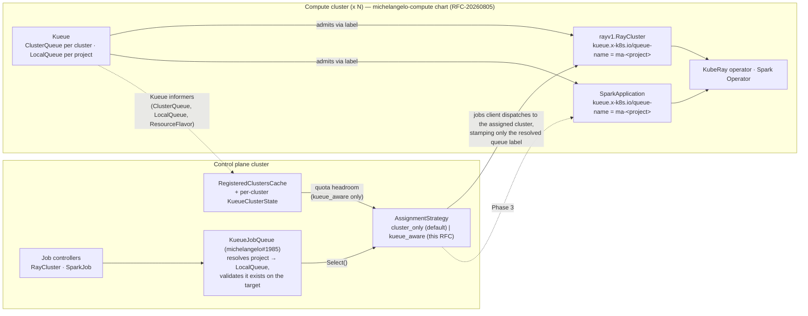
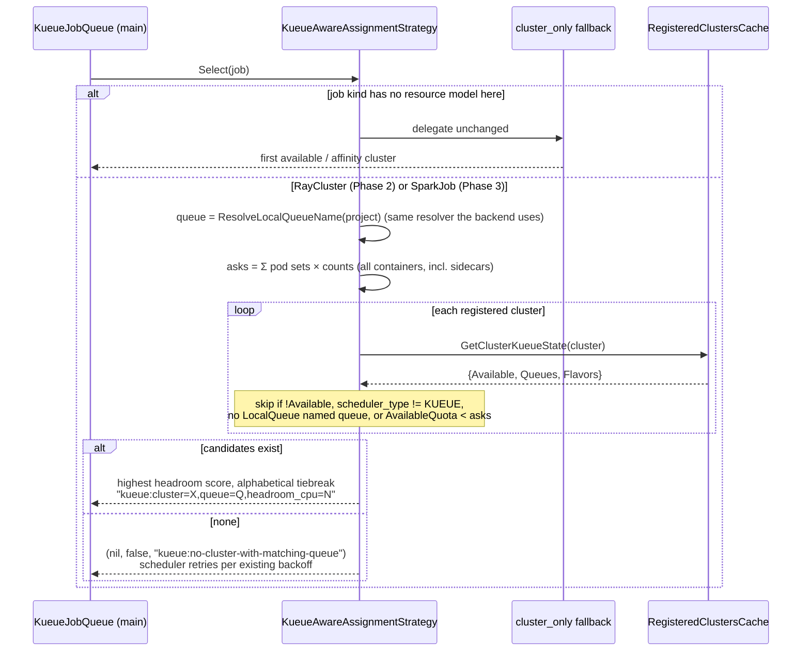

# RFC-20260731: Kueue-Aware Multi-Cluster Assignment for Ray and Spark Workloads

- **Status:** Draft
- **Author(s):** @dragod812
- **Created:** 2026-07-31

---

## Problem statement

Michelangelo now has a Kueue admission backend. [michelangelo#1985](https://github.com/michelangelo-ai/michelangelo/pull/1985) (merged 2026-09-22; designed in [enhancements#19](https://github.com/michelangelo-ai/enhancements/pull/19) by @apurvapatkeshwar) added a `scheduler_type` field on `ClusterSpec`, a `KueueJobQueue` backend selected by `jobs.scheduler.backend: kueue`, control-plane resolution of a job's project to a LocalQueue (`ma-{project}` by convention), an allowlisted label path that stamps exactly one label — `kueue.x-k8s.io/queue-name` — on dispatched RayClusters, and a `Queued` condition while Kueue holds a cluster suspended. Per compute cluster, Kueue's RayCluster integration now delivers job-level admission and quota-level gang admission for Ray, opt-in one cluster at a time.

What that leaves open is everything *around* per-cluster admission:

| # | Gap | State on `main` after michelangelo#1985 | This RFC |
|---|---|---|---|
| 1 | **Capacity-blind multi-cluster placement.** `ClusterOnlyAssignmentStrategy` picks the first available cluster or an affinity match. With several Kueue-managed clusters, a job can be routed to a full one and queue there while another sits idle. | Unchanged. The backend *predicts* the target with the same strategy and only validates that the resolved LocalQueue exists there. | Phase 2: a `kueue_aware` assignment strategy scores clusters by live quota headroom. |
| 2 | **Queueing still burns the 30-minute creation budget.** `DEFAULT_CREATE_CLUSTER_TIMEOUT_SECONDS` (`python/michelangelo/uniflow/plugins/ray/task.star`) becomes the readiness sensor's `ExpirationInterval` (`go/worker/plugins/ray/starlark_module.go`); a cluster held suspended for 31 minutes fails. | Unchanged. The `Queued` condition makes the wait visible but does not stop the clock. | Phase 0: split the budget at admission. |
| 3 | **Spark is not on compute clusters at all.** The Spark job controller creates the `SparkApplication` through the controller manager's own REST config — the control-plane cluster — with a hardcoded `spark-operator-spark` service account; the k8s-engine mapper returns "spark job mapping not implemented" for `SparkJob`. No queue label, no Kueue admission, no compute-cluster placement. | Unchanged. The backend is job-type agnostic, but only the Ray mapping exists. | Phase 3: dispatch SparkJobs to the assigned compute cluster and admit them through Kueue's SparkApplication integration. |
| 4 | **Nothing packages the compute side.** Kueue, its queue objects, the Spark Operator, and the control-plane identity are hand-installed per cluster from a guide. | The operator guide (`docs/operator-guides/jobs/kueue-scheduler-backend.md`) documents a manual `helm install` plus `kubectl apply`; `ma sandbox demo kueue` scripts the same for k3d. | Phase 1 rides on RFC-20260805's `michelangelo-compute` chart; this RFC settles *where each queue object lives*. |
| 5 | **No priority.** The allowlist stamps one label; nothing maps `SchedulingSpec.preemptible` or a future priority field onto a Kueue `WorkloadPriorityClass`. | Deliberately out of scope in #19. | Open question, with a proposed mapping. |
| 6 | **No hardware-aware routing defaults.** `ResourceFlavor` per SKU stays operator YAML. | Unchanged. | Non-goal; the extension path is named. |

## Motivation

Per-cluster admission solves the "one team exhausts the cluster" failure. It does not decide *which* cluster a job should queue on, and Michelangelo is explicitly multi-cluster: the control plane federates N registered compute clusters and already owns placement through `AssignmentStrategy`. Once two of those clusters are Kueue-managed, "first available" placement turns quota into a lottery — the job that lands on the busy cluster waits behind quota that the idle cluster has free. Surfacing each cluster's Kueue state to the control plane turns assignment into "most likely to admit quickly", and it does so at the interface the merged backend already consults, so no second seam is introduced.

The same per-cluster install has to carry Spark. Michelangelo's batch story is Ray *and* Spark (`SparkTask`, `run_spark_job()` from RFC-20260702, and every example project that preprocesses with Spark before training with Ray), and Kueue upstream now admits `SparkApplication`s natively. A compute cluster stack that gates Ray but leaves Spark racing for the same nodes only moves the contention.

## Goals

- **Kueue-aware placement.** With `jobs.scheduler.assignmentStrategy: kueue_aware`, the control plane picks the compute cluster whose resolved LocalQueue has the most headroom for the job's full ask, falling back to today's behavior for clusters and job kinds it cannot score. Default stays `cluster_only`.
- **Queueing never fails a job by timeout.** Time spent suspended by Kueue does not consume the Ray creation budget; the budget covers admission → readiness only.
- **One compute-cluster stack for Ray and Spark.** Every cluster that runs Michelangelo batch workloads installs the `michelangelo-compute` chart (RFC-20260805): KubeRay operator, Spark Operator, Kueue, the control-plane identity, and the cluster's queue objects.
- **A defined home for every queue object.** Cluster capacity (`ResourceFlavor`, `ClusterQueue`, optional `WorkloadPriorityClass` set) is chart-rendered per cluster; per-project `LocalQueue`s ship with the project definition, with `michelangelo-examples` carrying the reference layout.
- **Spark on compute clusters, admitted by Kueue.** `SparkJob`s dispatch to the assigned compute cluster as `SparkApplication`s carrying the control-plane-resolved queue label, gated by Kueue's `sparkoperator.k8s.io/sparkapplication` integration.
- **Zero proto or API changes.** Everything rides on the `scheduler_type` field and config surface that michelangelo#1985 added.

## Non-goals

- **Replacing the merged admission seam.** `KueueJobQueue` and `scheduler_type` are the base this RFC builds on; the original draft's alternative seam is recorded under Alternatives, not proposed.
- **MultiKueue** (Kueue's built-in multi-cluster dispatch) — see Alternatives.
- **True gang placement.** Kueue provides all-or-nothing *quota admission*; after admission the kube-scheduler still binds pods individually, so workers can queue behind real node capacity if quotas overstate it. Kueue's `waitForPodsReady` is the hardening knob — deliberately not enabled by default, both because it is installation-wide rather than per-queue and because eviction is destructive for a cluster that already went ready (see High-level architecture and Open questions).
- **Per-SKU hardware routing defaults.** The provisioned `default-flavor` is SKU-agnostic. `ResourceFlavor`s carrying node labels/taints per GPU SKU (A100 vs L40S, with in-queue fallback ordering) are the extension path via operator YAML, not shipped defaults.
- **Gating RayJobs.** Michelangelo's Ray path creates a RayCluster and then a RayJob that targets it via `spec.clusterSelector`, and Kueue deliberately ignores such RayJobs ([kueue#7218](https://github.com/kubernetes-sigs/kueue/issues/7218)). Gating the RayCluster gates everything that consumes capacity; the RayJob's submitter pod rides along outside quota. The merged mapper already stamps no queue label on RayJobs for this reason.
- **Auto-provisioning LocalQueues** from the control plane. Queues stay operator-authored in this RFC; the control plane validates existence (as it does today) and fails visibly.
- Kueue's borrowing / cohort / preemption features. Defaults are provisioned; operators layer these on via Kueue YAML.
- Surfacing Kueue queue positions in the Michelangelo UI (see Open questions).

## High-level architecture



### What the merged backend already does, and how this RFC composes with it

Three properties of michelangelo#1985 are load-bearing here, so they are stated rather than assumed:

1. **Queue selection is control-plane-owned.** The k8s engine resolves the LocalQueue from the job's project (`ma/project-name` label when stamped, otherwise the job's namespace) through `jobs.scheduler.kueue.localQueueTemplate` / `localQueueOverrides`, and `mapLabels` forwards *no* user labels to compute clusters. A pipeline cannot name a queue it does not own. This RFC keeps that contract unchanged for Ray and extends it, byte-for-byte, to Spark.
2. **Placement is still `AssignmentStrategy`'s.** `KueueJobQueue.Enqueue` predicts the target cluster by calling `AssignmentStrategy.Select`, then checks `scheduler_type` and LocalQueue existence on that cluster. A Kueue-aware strategy therefore upgrades placement for the merged backend with no change to the backend itself — the seam @apurvapatkeshwar identified as complementary on #19 is exactly the one used.
3. **There is no Kueue client-library coupling.** The LocalQueue existence check is a raw `GET` against `kueue.x-k8s.io/<apiVersion>` (default `v1beta2`, configurable). Phase 2's informers keep that property by reading Kueue objects through the dynamic client at the same configured `apiVersion`, so the control plane never pins a `sigs.k8s.io/kueue` Go module and the compute-side Kueue version is free to move (see Version compatibility).

### Prerequisite: queueing must escape the 30-minute creation budget

Two properties of the Ray path were prerequisites when this RFC was first drafted. The first — the control plane must not destroy suspended clusters — landed as the non-terminal `RAY_CLUSTER_STATE_SUSPENDED` ([michelangelo#1700](https://github.com/michelangelo-ai/michelangelo/pull/1700)), and michelangelo#1985 layers the `Queued` condition (`AwaitingAdmission` → `ClusterAdmitted`) on top of it. The second is still open and gates safe use of queueing at any depth.

The entire create-and-wait path shares a single 1800-second budget: `DEFAULT_CREATE_CLUSTER_TIMEOUT_SECONDS = 60 * 30` in `task.star` is passed to `ray.create_cluster`, and the Go plugin assigns it to the readiness sensor's `ExpirationInterval`. On expiry the plugin terminates the cluster and fails the task. That budget was sized for *provisioning* — pulling images and starting pods — but it also covers *waiting for admission*. Left alone, a job legitimately queued behind quota for 31 minutes fails, which contradicts the central promise that jobs queue instead of failing, and it fails more often the deeper the queue — exactly when queueing is doing its job. The same constant derives `RAY_NUM_REDIS_GET_RETRIES`, the existing workaround for the absence of gang scheduling.

The design splits the budget by phase:

- While the cluster is `SUSPENDED` (the `Queued` condition is `True`), the readiness sensor does not consume the creation budget. The admission wait is bounded by Kueue-native mechanisms and, optionally, an operator-set queue timeout, and is reported through the suspended state rather than as a pending failure.
- The 1800-second budget starts when Kueue flips `suspend=false`, covering admission → readiness, which is the phase it was always sized for.

This touches the sensor activity and the Ray plugin and is **Phase 0** below. On Kueue-managed clusters the inflated `RAY_NUM_REDIS_GET_RETRIES` also becomes unnecessary, since gang admission removes the condition it compensates for; the default stays for non-Kueue clusters.

### Phase 1 — the compute-cluster stack and where queue objects live

**Install.** Every cluster that runs Michelangelo batch workloads installs the `michelangelo-compute` chart (RFC-20260805): KubeRay operator, Spark Operator, Kueue (as a condition-gated subchart, released alongside the operators), the control-plane identity RBAC, and the cluster's queue objects, in the two-phase order that CRD establishment requires. The operator then marks the cluster `scheduler_type: SCHEDULER_TYPE_KUEUE` and enables `jobs.scheduler.backend: kueue` on the control plane, exactly as the merged guide describes. Installing the chart on a cluster whose `Cluster` CR is *not* marked is safe: the backend stamps no label, and Kueue with `manageJobsWithoutQueueName: false` (upstream default) observes and admits nothing.

**Namespace invariant.** Kueue admits a workload only if the referenced LocalQueue exists in the *workload's* namespace. The jobs client creates KubeRay RayClusters in the fixed local namespace (`default`, `RayLocalNamespace`), so every LocalQueue lives in `default` and per-project queues are distinguished by name (`ma-<project>`), not namespace. Phase 3 keeps the same invariant for `SparkApplication`s. Materializing per-project namespaces on compute clusters would strengthen tenancy and this topology would inherit it transparently, but it is separate scope (mapper, RBAC, cleanup) — see Open questions.

**Where the queue objects live.** The objects have different cardinalities and different owners, so they should not share one home:

| Object | Cardinality | Owned by | Home |
|---|---|---|---|
| `ResourceFlavor`, `ClusterQueue`, optional `WorkloadPriorityClass` set | one set per compute cluster | the cluster operator (capacity) | Rendered by the `michelangelo-compute` chart from `kueueQueues.*` values; the sandbox's per-cluster values are the worked example. |
| `LocalQueue` `ma-<project>` | one per project, on every Kueue-managed cluster the project may land on | project onboarding | Authored with the project definition. The chart renders them from a `kueueQueues.localQueues` list for platform-managed installs; the human-readable reference lives next to the project's own manifests. |

`michelangelo-examples` was evaluated as the home for that reference, and it fits the LocalQueue half well — with limits worth stating:

- **The layout already matches.** Each example project is a directory with `config/project.yaml` (the Michelangelo `Project` CR, namespace `california-housing`, `bert-cola`, …) plus its pipelines, and `bert_cola/inferenceserver/` already ships non-pipeline manifests (`InferenceServer`, `Deployment`) as reference YAML applied by hand. A `config/kueue/localqueue.yaml` per project — `LocalQueue ma-california-housing` in namespace `default`, pointing at the cluster's `ClusterQueue` — is the same pattern, and it documents the naming and namespace contract (`localQueueTemplate`, `RayLocalNamespace`) exactly where a project author sees it. Onboarding a project to a Kueue-managed fleet then reads: apply `project.yaml` on the control plane, apply the project's LocalQueue on each compute cluster.
- **It should not be the source of truth for cluster capacity.** `ClusterQueue` quotas are per-cluster operator decisions; a copy in an examples repo would drift from the clusters it describes. The chart values own those, and Kueue upstream already publishes the generic single-ClusterQueue example (`kueue.sigs.k8s.io/examples/admin/single-clusterqueue-setup.yaml`) — the examples repo should show the Michelangelo-specific contract, not re-teach Kueue.
- **Packaging and audience are a mismatch to manage, not a blocker.** `michelangelo-examples` is a pip-installable wheel and a per-project container image aimed at pipeline authors ("try it in five minutes"), and its CI runs lint, import, and local-run smoke tests — nothing validates Kubernetes manifests. Queue YAML there is reference material for the sandbox tier, like the inference-server manifests, and should be labeled as such; a `kubeconform`/dry-run check is cheap to add if it grows.

The recommendation, carried into RFC-20260805's values schema: chart-rendered capacity objects, a chart-rendered *list* of LocalQueues for fleets that manage projects centrally, and a per-project LocalQueue reference in `michelangelo-examples` for the "onboard one project by hand" path — both producing the identical object.

**Eviction is not uniformly recoverable, and the difference matters.** Kueue can evict an admitted workload (preemption, or a `waitForPodsReady` timeout if an operator enables it), and the consequences depend on whether the cluster had already become ready:

- **Evicted before ready** — preempted while still pending, or pods never all came up. Kueue re-suspends the object and requeues it. The cluster returns to `SUSPENDED`, the readiness sensor keeps waiting (per the budget split above), and nothing fails. This is the well-behaved path.
- **Evicted after ready, with a Ray job running on it** — the workers are deleted and the running task fails. Recovery is Uniflow's existing task-level retry: a fresh submission that queues like any new job, losing in-progress work. There is no transparent mid-run requeue, and providing one would require checkpoint-aware resubmission that is out of scope here.

Preemption policies and `waitForPodsReady` timeouts are therefore not free to enable on clusters running long training jobs — a point the operator guide must make alongside the `waitForPodsReady` blast-radius caveat in Open questions.

### Phase 2 — Kueue-aware multi-cluster assignment

The assignment decision under `jobs.scheduler.assignmentStrategy: kueue_aware`:



1. **Informer-backed cache.** For every registered cluster whose `scheduler_type` is `SCHEDULER_TYPE_KUEUE`, the cluster controller runs dynamic-client informers for `clusterqueues`, `resourceflavors` (cluster-scoped) and `localqueues` (all namespaces) at the configured `jobs.scheduler.kueue.apiVersion`, with a 5-minute resync, maintaining a per-cluster snapshot in `RegisteredClustersCache`:
   - `ClusterQueueSnapshot{Name, NominalQuota, UsedQuota, AvailableQuota, Flavors, LocalQueueNames}` with `AvailableQuota = max(0, Nominal − Used)` per resource, nominal read from `spec.resourceGroups[].flavors[].resources[]` and usage from the ClusterQueue's flavor-usage status, summed across flavors and resource groups.
   - `KueueClusterState{Available, Queues, Flavors}` — `Available=false` when Kueue is absent. Absence is detected by classifying list errors (`NotFound` or `NoKindMatchError`), logged once per cluster, and never blocks cluster registration.
   - Lifecycle: informers start when a cluster registers (or is marked Kueue-managed) and are cancelled when it is removed, unmarked, or the manager shuts down.
2. **`KueueAwareAssignmentStrategy`** (selected by config, below):
   - **Fallback (required):** `AssignmentStrategy` is shared by all batch job types. The strategy embeds a `cluster_only` fallback and delegates any job kind it has no resource model for — every non-Ray kind until Phase 3, and any job bound by affinity. Without this, enabling `kueue_aware` would make those jobs permanently unschedulable.
   - Resolve the queue with the *same* resolver the backend uses (`ResolveLocalQueueName(project)`), so placement and validation can never disagree about which LocalQueue a job wants.
   - Sum resource asks over the job's pod sets: for a RayCluster, head + each worker group × `MinInstances`, in milli-units, summing **every container** in each pod template rather than `containers[0]` alone. Ray pods are not single-container when log persistence is enabled: `injectCollectorSidecar` adds a collector to the head *and* every worker template (`k8sengine/ray.go`). Counting only the first container understates each pod's real request, which inflates apparent headroom and lets the strategy route a job to a cluster that then cannot admit it — the precise failure this strategy exists to prevent, and one whose magnitude scales with worker count.
   - Candidate filter per cluster: `state.Available`, a LocalQueue named `queue` in the dispatch namespace, and its ClusterQueue's `AvailableQuota` covering every asked resource (a resource the queue doesn't declare counts as zero).
   - Score: Σ over {cpu, memory, nvidia.com/gpu} of `(available − ask) / nominal`; resources with zero nominal quota are skipped (prevents division by zero and score domination). Highest score wins; ties break alphabetically by cluster name for determinism.
   - Reason strings are prefixed `kueue:` (`kueue:cluster=X,queue=Q,headroom_cpu=N` on success, `kueue:no-cluster-with-matching-queue` on miss) so assignment decisions are grep-able in scheduler logs. On miss the scheduler retries per its existing backoff.
3. **Multi-cluster sandbox.** `--compute-cluster-name` becomes repeatable (and `--num-compute-clusters N` auto-names), with `--compute-cluster-quotas` accepting per-cluster overrides passed as `kueueQueues.quota` chart values on the phase-2 upgrade (Helm's deep merge keeps unspecified resources at chart defaults) — so a two-cluster sandbox gives the strategy a meaningful choice to verify end to end.

### Phase 3 — Spark on compute clusters

Spark today is control-plane-local: the Spark job controller (`go/components/spark/job`) builds a `SparkApplication` and creates it with the controller manager's own client, in the `SparkJob`'s namespace, with a hardcoded `spark-operator-spark` service account, on whichever cluster the control plane runs on. The scheduler framework already models `BatchSparkJob`, but the federated jobs client's mapper has no Spark case. Bringing Spark onto the compute-cluster stack is three aligned changes:

1. **Dispatch through the federated jobs client.** Implement the `SparkJob` → `SparkApplication` mapping in `k8sengine`, so a SparkJob is assigned a cluster by `AssignmentStrategy`, validated by `KueueJobQueue`, and created on that cluster through the same path RayClusters use. The queue label comes from the same `kueueQueueName` resolver; user labels still do not cross the boundary. The mapping keeps the driver/executor pod specs Michelangelo already builds and adds the identity contract the compute chart establishes: the Spark Operator's per-namespace `spark-operator-spark` service account in every namespace SparkApplications are created in (`spark.jobNamespaces`), and `sparkoperator.k8s.io` verbs on the control-plane identity (RFC-20260805).
2. **Admission via Kueue's SparkApplication integration.** Kueue admits `SparkApplication`s natively from v0.17 (alpha, feature gate `SparkApplicationIntegration`, framework `sparkoperator.k8s.io/sparkapplication`), suspend-based like the Ray integrations, with pod sets for the driver and `executor.instances` executors. Two constraints shape Michelangelo's mapping: **cluster mode only** (already the case), and **dynamic allocation is rejected by webhook** — `executor.instances` must be explicit. The Spark Operator must be v2.4.0 or newer, the release that added `spec.suspend`. Both requirements are chart pins in RFC-20260805; until a cluster meets them, SparkJobs dispatched there are placed by `cluster_only` and admitted immediately, exactly as Ray was before Kueue.
3. **Headroom for Spark.** The `kueue_aware` strategy gains a Spark resource model: driver pod + `executor.instances` × executor pod, every container counted, using the same score. Until item 1 lands, SparkJobs take the fallback path; nothing about the strategy's interface changes.

Kueue's own guidance on JVM overhead applies to quota sizing: the operator guide should tell operators whether `memoryOverheadFactor` is folded into the executor request (see Open questions, quota sizing inputs).

### How the design maps to the problems

| # | Problem | Mechanism | Status |
|---|---|---|---|
| 1 | Capacity-blind multi-cluster placement | `kueue_aware` assignment scores clusters by quota headroom, using the merged backend's own queue resolver (Phase 2). | Designed (opt-in) |
| 2 | Queueing burns the creation budget | Budget split at admission; suspended time is reported, not charged (Phase 0). | Designed; prerequisite for enabling queueing at depth |
| 3 | Spark not on compute clusters / not admitted | Federated dispatch of `SparkApplication`s with the resolved queue label; Kueue `sparkoperator.k8s.io/sparkapplication` integration (Phase 3). | Designed; gated on Kueue ≥ 0.17 and Spark Operator ≥ 2.4.0 |
| 4 | Compute side unpackaged; queue objects have no home | `michelangelo-compute` chart (RFC-20260805) renders capacity objects and a LocalQueue list; per-project LocalQueue reference in `michelangelo-examples` (Phase 1). | Designed |
| 5 | Priority | Map `SchedulingSpec.preemptible` (and a future priority field) to a `WorkloadPriorityClass` stamped by the control plane, never by users. | Open question |
| 6 | Hardware-aware routing | `ResourceFlavor` per SKU is the abstraction; Phase 2 routes *across clusters* by live capacity. | Extension path only |

## APIs and CRDs

No Michelangelo proto or CRD schema changes; `scheduler_type` already exists. The public surface delta:

**controllermgr config** (under the `jobs.scheduler` tree michelangelo#1985 introduced; absent key preserves current behavior, unknown values fail at startup like `backend` does):

```yaml
jobs:
  scheduler:
    backend: kueue                       # existing (michelangelo#1985)
    assignmentStrategy: cluster_only     # new: "cluster_only" (default) | "kueue_aware"
    kueue:
      localQueueTemplate: "ma-{project}" # existing
      apiVersion: v1beta2                # existing; informers use the same version
```

**Provisioned Kueue resources** (operator contract, per Kueue-managed cluster; rendered by the `michelangelo-compute` chart, defaults shown — the LocalQueue is the per-project object that also ships as the `michelangelo-examples` reference):

```yaml
apiVersion: kueue.x-k8s.io/v1beta2
kind: ResourceFlavor
metadata: {name: default-flavor}
spec: {}
---
apiVersion: kueue.x-k8s.io/v1beta2
kind: ClusterQueue
metadata: {name: cluster-queue}
spec:
  namespaceSelector: {}
  queueingStrategy: BestEffortFIFO
  resourceGroups:
  - coveredResources: ["cpu", "memory", "nvidia.com/gpu"]
    flavors:
    - name: default-flavor
      resources:
      - {name: cpu, nominalQuota: 16}
      - {name: memory, nominalQuota: 32Gi}
      - {name: "nvidia.com/gpu", nominalQuota: 4}
---
# One per project, in the namespace where the control plane dispatches
# workloads (RayLocalNamespace, "default"), named by localQueueTemplate.
apiVersion: kueue.x-k8s.io/v1beta2
kind: LocalQueue
metadata: {name: ma-california-housing, namespace: default}
spec: {clusterQueue: cluster-queue}
```

**Labels on dispatched objects** — unchanged from michelangelo#1985: exactly `kueue.x-k8s.io/queue-name: ma-<project>`, set by the control plane, on RayClusters (today) and SparkApplications (Phase 3). No user label crosses the cluster boundary.

### Version compatibility

- **Control plane:** no Kueue Go dependency. The existence check and the Phase 2 informers speak `kueue.x-k8s.io/<jobs.scheduler.kueue.apiVersion>` (default `v1beta2`), so the control plane's `k8s.io/*` pin and Kueue's release line are decoupled — the constraint the original draft worked around no longer exists.
- **Compute clusters:** Kueue **≥ 0.15** (first release serving `v1beta2`, and it carries the `clusterSelector` skip this design relies on); **≥ 0.17** with `SparkApplicationIntegration` enabled for Phase 3. `v1beta1` is deprecated upstream and being retired in the 0.20 line, so new installs should not start there; operators on older Kueue set `kueue.apiVersion: v1beta1`. The concrete chart pin and its bump cadence are RFC-20260805's.
- **Spark Operator ≥ 2.4.0** on clusters that gate Spark.

## Alternatives considered

### Alternative A: `queue_name` / `priority_class_name` fields on the `RayClusterSpec` proto
The original internal spec's design.
**Pros:** typed, discoverable API; validation at CR-creation time.
**Cons:** proto change fans out into Go and Python codegen with strict cross-language ordering; duplicates data that must ultimately become a Kubernetes label; and — decisive after michelangelo#1985 — a user-settable field would reintroduce the user-chosen-queue problem the merged backend closed.
**Why not chosen:** the queue is derived from project identity on the control plane; there is nothing for a user-facing field to carry.

### Alternative B: user-supplied queue via a Starlark `ray_cluster_spec(queue=...)` parameter (this RFC's original Phase 1)
**Pros:** smallest possible first step; no control-plane notion of project ownership required.
**Cons:** isolation between projects becomes advisory — a pipeline can draw against any queue by naming it — and it puts the label writer in the wrong layer. @apurvapatkeshwar raised exactly this on #19; the honest answer is that it was a sequencing shortcut, not a preference.
**Why not chosen:** server-side resolution is on `main`. Phase 2 is the part of this RFC that was always meant to follow it.

### Alternative C: extend `AssignmentStrategy` instead of adding a `JobQueue` backend (this RFC's original seam)
**Pros:** placement and the decision to stamp a queue label are made in one place; no new interface implementation.
**Cons:** the `JobQueue` backend is what enforces *validation* at enqueue time (LocalQueue exists, project resolvable) and surfaces `Enqueued=False` with an actionable reason; folding that into placement would blur two responsibilities the merged design keeps apart.
**Why not chosen:** michelangelo#1985 landed the `JobQueue` seam, and it composes with a Kueue-aware strategy without modification — the backend already calls `AssignmentStrategy.Select` to predict its target. The two designs turned out to be layers, not rivals, which is the framing #19's author proposed and this RFC adopts.

### Alternative D: MultiKueue (Kueue-native multi-cluster dispatch)
**Pros:** upstream-supported multi-cluster admission; single control-plane queue view.
**Cons:** requires a management-cluster Kueue deployment plus per-cluster kubeconfig plumbing inside Kueue's own controllers, running *beside* Michelangelo's existing scheduler — two placement brains; harder incremental rollout.
**Why not chosen:** Michelangelo already owns cluster assignment via `AssignmentStrategy`. Feeding Kueue state into the existing strategy interface is a far smaller, reversible step. MultiKueue remains a possible future direction.

### Alternative E: single Kueue in the control plane admitting v2pb CRs
**Pros:** one Kueue install; queueing before assignment.
**Cons:** Kueue has no integration for Michelangelo's CRDs (a custom framework plugin to build and maintain); quota is inherently a per-compute-cluster property, which a control-plane queue cannot see without exactly the state-sync this RFC builds anyway.
**Why not chosen:** highest custom-code burden for the least upstream leverage.

## Open questions

- [ ] **Priority mapping.** The merged allowlist forwards no priority label, correctly. The proposed first step is control-plane-stamped: `SchedulingSpec.preemptible: true` → a low `WorkloadPriorityClass`, everything else → default, with the class set (`high`/`default`/`low`) rendered by the compute chart so a stamped name always exists. Is `preemptible` the right first input, or should this wait for a typed priority field (michelangelo#929)?
- [ ] **Queued-state *reason* and UX.** `Queued=True/AwaitingAdmission` says "not running", not "waiting behind 40 GPUs of quota". Kueue's `Workload` status carries the admission reason (`QuotaReserved` pending, `Inadmissible` with message); watching Workloads alongside the Phase 2 informers is the natural way to reflect it into the RayCluster/SparkJob status and the UI. Condition message, dedicated field, or `kubectl`-level detail?
- [ ] **Headroom estimate vs autoscaling.** Resource asks use `MinInstances` per worker group, so headroom is optimistic for clusters that autoscale toward `MaxInstances`. Is min-based admission the right long-term contract, or should the strategy (and quota checks) consider max?
- [ ] **Per-project namespaces on compute clusters.** All Ray objects dispatch into `default`, so LocalQueues are name-scoped and namespace-selector isolation is unavailable. Materializing per-project namespaces (mapper, RBAC, cleanup, Spark Operator `jobNamespaces`) is a real tenancy improvement; should Phase 3 — which touches the mapper anyway — reserve it, or is it a separate RFC?
- [ ] **LocalQueue lifecycle.** This RFC keeps queues operator-authored (chart list or per-project YAML) with dispatch-time validation. Should the control plane eventually create `ma-<project>` on Kueue-managed clusters when a project is onboarded, and if so is `michelangelo-examples`' per-project reference still worth keeping as documentation?
- [ ] **`waitForPodsReady`.** Enabling Kueue's all-or-nothing startup closes two gaps at once — quota admission vs true gang placement, and crashlooping jobs holding GPUs — but it is Kueue **installation-wide** `Configuration`, not per-ClusterQueue (a per-queue override is only an open upstream request, [kueue#7542](https://github.com/kubernetes-sigs/kueue/issues/7542)), so it governs *every* Kueue-managed workload on that compute cluster, and the merged guide advises against it for RayClusters whose workers start over a window. What timeout/backoff defaults, if any, are safe for ML workloads with long image pulls, and should the chart expose it at all?
- [ ] **Quota sizing inputs.** Facts operators need when setting `nominalQuota`, currently undocumented: the log-collector sidecar (100m CPU / 128Mi when log persistence is enabled) is counted *inside* the gated Ray pod sets, on the head and every worker; the RayJob submitter pod runs *outside* Kueue quota; for Spark, the JVM `memoryOverheadFactor` is part of the executor request Kueue sees. A worked sizing example in the operator guide, or is stating the facts sufficient?
- [ ] **Per-SKU ResourceFlavor taxonomy.** Ship flavors for common GPU SKUs with fallback ordering inside the default ClusterQueue, or leave flavor design to operators? Defaults make "run on A100s, fall back to L40S" declarative but couple the platform to a hardware catalog.

## Rollout strategy

- **Phase 0 — prerequisite, before enabling queueing at any depth:** the creation-budget split in the Ray plugin and readiness sensor, so suspended time no longer consumes the 1800-second provisioning budget. `RAY_CLUSTER_STATE_SUSPENDED` (michelangelo#1700) and the `Queued` condition (michelangelo#1985) are already on `main`.
- **Phase 1 — shippable alone:** the `michelangelo-compute` chart (RFC-20260805) installed on every sandbox cluster that runs batch workloads, rendering the capacity objects and the LocalQueue list; the per-project LocalQueue reference in `michelangelo-examples`; the operator guide's manual `helm install` + `kubectl apply` replaced by the chart's two commands. Backward compatible: unmarked clusters see no label and Kueue admits nothing.
- **Phase 2 — opt-in:** per-cluster Kueue informers via the dynamic client; `KueueAwareAssignmentStrategy` behind `jobs.scheduler.assignmentStrategy`; the multi-cluster sandbox. Rollback is unsetting the flag — assignment reverts instantly; Phase 1 admission continues unaffected.
- **Phase 3 — Spark:** federated `SparkJob` dispatch with the resolved queue label; Spark Operator ≥ 2.4.0 and Kueue ≥ 0.17 with the SparkApplication framework enabled via the chart; Spark resource model in the strategy. Clusters below the floor keep immediate admission for Spark, per cluster.
- **Feature flags:** `jobs.scheduler.backend` (existing) and `jobs.scheduler.assignmentStrategy` (new) default to today's behavior; `scheduler_type` opts clusters in one at a time.
- **Kueue-less clusters:** never fail registration; they are skipped by `kueue_aware` and fully served by `cluster_only`.
- **Production clusters:** the sandbox flow is the reference; production compute clusters install the same chart through their own provisioning pipelines, overriding `kueueQueues.*` (quotas sized to real capacity, the project LocalQueue list, priority classes as needed).

## References

- [RFC-20260805: Compute Cluster Helm Chart](../20260805-compute-cluster-helm-chart/20260805-compute-cluster-helm-chart.md) — the Ray + Spark compute-cluster stack this RFC's Phase 1 rides on
- [enhancements#19](https://github.com/michelangelo-ai/enhancements/pull/19) — RFC for the Kueue scheduler backend (@apurvapatkeshwar); [michelangelo#1985](https://github.com/michelangelo-ai/michelangelo/pull/1985) — its landing on `main`, with the operator guide `docs/operator-guides/jobs/kueue-scheduler-backend.md`
- [michelangelo#1700](https://github.com/michelangelo-ai/michelangelo/pull/1700) — non-terminal `RAY_CLUSTER_STATE_SUSPENDED`
- Prior art: [michelangelo#1129](https://github.com/michelangelo-ai/michelangelo/pull/1129), "Integration Kueue into compute cluster scheduler for ray job" — validated suspend/admit end to end on two k3d compute clusters
- [RFC-20260702: `run_spark_job()`](../20260702-uniflow-spark-plugin/20260702-uniflow-spark-plugin.md) — the Spark entrypoints that share the compute stack
- [michelangelo-examples](https://github.com/michelangelo-ai/michelangelo-examples) — per-project layout (`config/project.yaml`, `inferenceserver/`) the LocalQueue reference follows
- [kueue#7218](https://github.com/kubernetes-sigs/kueue/issues/7218) — Kueue skips RayJobs with `spec.clusterSelector`
- [kueue#7542](https://github.com/kubernetes-sigs/kueue/issues/7542) — open request for per-ClusterQueue `waitForPodsReady`
- Kueue: https://kueue.sigs.k8s.io/ (installation: https://kueue.sigs.k8s.io/docs/installation/; single-ClusterQueue example: https://kueue.sigs.k8s.io/docs/tasks/manage/administer_cluster_quotas/)
- Kueue RayCluster integration: https://kueue.sigs.k8s.io/docs/tasks/run/rayclusters/
- Kueue SparkApplication integration: https://kueue.sigs.k8s.io/docs/tasks/run/kubeflow/sparkapplications/
- WorkloadPriorityClass: https://kueue.sigs.k8s.io/docs/concepts/workload_priority_class/
- waitForPodsReady (all-or-nothing startup): https://kueue.sigs.k8s.io/docs/tasks/manage/setup_wait_for_pods_ready/
- MultiKueue: https://kueue.sigs.k8s.io/docs/concepts/multikueue/
- Kubeflow Spark Operator: https://github.com/kubeflow/spark-operator (suspend/resume from v2.4.0)
