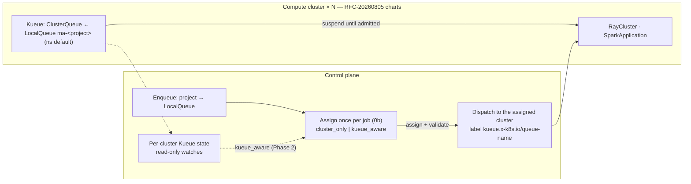

# RFC-20260731: Kueue-Aware Multi-Cluster Assignment for Ray and Spark Workloads

- **Status:** Draft
- **Author(s):** @dragod812
- **Created:** 2026-07-31
- **Revised:** 2026-10-20

---

## Summary

[michelangelo#1985](https://github.com/michelangelo-ai/michelangelo/pull/1985), designed in [enhancements#19](https://github.com/michelangelo-ai/enhancements/pull/19), gives compute clusters opt-in Kueue admission. On a cluster marked `scheduler_type: SCHEDULER_TYPE_KUEUE`, the control plane labels each RayCluster with its project's LocalQueue, and Kueue holds the cluster suspended until quota admits it. That is enough for one cluster in a sandbox, but not for a production fleet: defects make queueing unsafe to enable, placement ignores the quota state Kueue tracks, and Spark is not covered.

| Phase | This RFC decides |
|---|---|
| 0 | Safety fixes to the merged backend: bounded waits, one placement decision per job, project identity, Kueue read access, an accurate view of each cluster, dispatch retries |
| 1 | Who owns each Kueue object, and the quota model |
| 2 | The opt-in `kueue_aware` placement rule |
| 3 | What Kueue admission requires of Spark on compute clusters |

It builds on [RFC-20260805](../20260805-compute-cluster-helm-chart/20260805-compute-cluster-helm-chart.md), which packages the compute side, and on [enhancements#20](https://github.com/michelangelo-ai/enhancements/pull/20) for namespace-bound authorization. It needs no proto or CRD changes.

| Term | Meaning |
|---|---|
| Compute cluster | A Kubernetes cluster registered through a `Cluster` CR, to which the control plane dispatches workloads |
| Kueue-managed | A compute cluster whose `Cluster` CR sets `scheduler_type: SCHEDULER_TYPE_KUEUE` |
| Ready (cluster) | A compute cluster whose latest health probe succeeded; distinct from a RayCluster's `READY` state |
| LocalQueue / ClusterQueue | Kueue's namespaced queue / the cluster-scoped quota pool it feeds |
| Assign / dispatch | Record a job's target cluster / create the job's object on that cluster |
| Ask | What Kueue charges for a job: the sum of resource requests over every pod it creates |
| Admission | Kueue reserving the ask and unsuspending the workload |

## Background: the job path on `main`

Paths are under `go/components/` unless noted.

| Step | Behavior | Code |
|---|---|---|
| Placement | `cluster_only` returns the cluster named by the `michelangelo/cluster-affinity` label. Otherwise it returns the first entry of an unordered map of *all* registered clusters, whether ready or not, full or idle. | `jobs/scheduler/framework/cluster_only_assignment_engine.go`, `jobs/cluster/types.go` |
| Enqueue (`jobs.scheduler.backend: kueue`) | Calls `Select` to *predict* the target. If the target is Kueue-managed: the project is the `ma/project-name` label, or else the namespace; the LocalQueue is the override, or else `ma-{project}`; the backend GETs that LocalQueue on the target. NotFound gives `Enqueued=False/KueueQueueNotFound`; any other error gives `KueueQueueCheckFailed`. Both are retried on later reconciles. | `jobs/scheduler/kueue/`, `jobs/common/utils/utils.go` |
| Assignment | The scheduler calls `Select` *again* and assigns the job to that result. | `jobs/scheduler/scheduler.go` |
| Dispatch | On a Kueue-managed cluster, under either backend, stamps exactly one label, `kueue.x-k8s.io/queue-name`, on the RayCluster and never on RayJobs; the RayCluster goes to namespace `default`. Any create error other than AlreadyExists fails the RayCluster (`ClusterCreationFailed`). | `jobs/client/k8sengine/mapper.go`, `ray/cluster/controller.go` |
| Waiting | While Kueue holds the RayCluster, its state is `SUSPENDED` and it carries `Queued=True/AwaitingAdmission`, restamped on every 10 s reconcile; the condition turns False only at `READY`. Meanwhile the Uniflow readiness sensor keeps spending its 1800 s creation budget, and when the budget expires it terminates the cluster; under Temporal the budget never expires. | `ray/cluster/controller.go`; `python/.../uniflow/plugins/ray/task.star`, `go/worker/plugins/ray/starlark_module.go`; starlark-worker's Temporal adapter |
| Cluster view | The cluster controller refreshes its cached `Cluster` only when host, port, region, zone, DC or SLA change, and each cluster's client, credentials included, is cached for the process lifetime, so a `scheduler_type` edit or a new token needs a restart. A failed health probe is discarded: an unreachable cluster stays Ready. | `jobs/cluster/`, `jobs/compute/factory.go`, `jobs/client/helper.go` |
| Spark | The `SparkApplication` is created on the control-plane cluster, bypassing the scheduler, with the driver SA hardcoded to `spark-operator-spark`. The mapper rejects `SparkJob`, the federated client's Spark operations are stubs, and the controller recognizes three application states. | `spark/job/`, `jobs/client/` |

## Problem statement

| # | Problem | Consequence |
|---|---|---|
| P1 | **Queued time burns the Ray creation budget.** A single 1800 s deadline covers both admission and provisioning. | A job queued for 31 minutes fails, and this happens more often the deeper the queue, which is exactly when queueing is doing its job. |
| P2 | **Placement is decided twice.** Enqueue validates the cluster its `Select` predicted, then the scheduler assigns the job to the result of its own `Select`. | The two agree only while the strategy is deterministic and the cluster set is static. Any strategy that reads live state, P4's fix included, would dispatch jobs to clusters that were never validated. |
| P3 | **Project identity is set by the caller.** The `ma/project-name` label overrides the namespace, and nothing in OSS stamps or strips it. | Any pipeline can use another project's LocalQueues by setting one label, and so run on clusters its own project was never onboarded to. |
| P4 | **Placement ignores capacity and readiness.** | A job can queue behind full quota on one cluster while another sits idle, or be sent to an unreachable cluster, which still reports Ready. |
| P5 | **Kueue-managed clusters are unsafe to operate.** The `ray-manager` identity is granted `ray.io` only. Marking a cluster or rotating its token needs a controller restart. A webhook blip fails the job. Nothing packages the compute side. | The enqueue-time LocalQueue GET is denied (`KueueQueueCheckFailed`). Rollout and rollback by marking silently do nothing. Kueue's fail-closed webhook turns any brief outage into permanent job failures. Every operator assembles and configures Kueue by hand. |
| P6 | **Spark never reaches compute clusters.** | Spark gets no placement, no queue label and no admission. |

## Goals

- **G1 (P1):** Every wait for capacity is bounded by the control plane, provisioning keeps its own budget, and every expiry ends with cleanup and a specific reason.
- **G2 (P2):** Each job gets one placement decision, validated on the cluster it runs on.
- **G3 (P3):** On Kueue-managed clusters, a job uses only its own project's LocalQueues.
- **G4 (P4):** Opt-in placement on the cluster most likely to admit the job soonest, degrading to today's order, never to an outage, when Kueue state is missing.
- **G5 (P5):** Cluster changes take effect without a restart, brief outages fail no job, and every Kueue object has one owner.
- **G6 (P6):** Spark on compute clusters gets the same admission contract as Ray.
- **G7:** No proto or CRD changes. Without the Kueue backend, behavior changes only where `main` is wrong: cluster changes and failed probes take effect (0e), and transient create errors are retried (0f).

## Non-goals

- **Gang placement and preemption.** Kueue admits quota all-or-nothing, but the kube-scheduler still binds pods one at a time, so quotas should not exceed real capacity. Preemption stays off, because evicting a running cluster kills its job and recovery is only Uniflow's task retry.
- **Gating RayJobs.** Michelangelo's RayJobs attach to an existing RayCluster through `clusterSelector`, and Kueue deliberately skips such RayJobs. Gating the RayCluster already gates the capacity; the submitter pod runs outside quota.
- **Cohorts, borrowing and multi-flavor ClusterQueues.** These are operator configuration. Placement cannot compute free quota for such queues, so it ranks them by queue depth (Phase 2).
- **Moving Spark execution to compute clusters, and per-project namespaces on them.** Each is its own RFC. Phase 3 defines only the Kueue contract the first must meet.
- **MultiKueue, or a control-plane Kueue.** See Alternatives.

## Design



### Phase 0 — make the merged backend safe to enable

These changes are a prerequisite for marking any cluster outside a sandbox.

**0a. Two bounded clocks (P1).**

| Clock | Counts | Bound | Enforced by | On expiry |
|---|---|---|---|---|
| Admission wait | Time waiting for admission, from creation and again from each eviction: time before dispatch and time `SUSPENDED`. Dispatch to a non-Kueue cluster counts as admission. | `jobs.scheduler.kueue.admissionTimeout`, default `24h` | RayCluster controller | The RayCluster fails with `AdmissionTimeout`, and its compute-side object, if any, is deleted, releasing its queue position. |
| Provisioning | Time from creation to `READY`, excluding time `SUSPENDED`, cumulative across evictions | The Uniflow task budget, default 1800 s | Uniflow readiness sensor | The task fails with the RayCluster's latest condition reason, and the RayCluster is terminated. |

The rules behind the table:

- **`Queued` becomes exact.** It is True exactly while the RayCluster is `SUSPENDED`, and it is written only when it changes, so its timestamp is the transition time; a cluster admitted before it is seen suspended records False once, at admission. The clocks then need no new field: the admission clock starts at the RayCluster's creation or its latest eviction (a `Queued` transition), and the sensor keeps the remaining budget in workflow state, spending none of it while the RayCluster is `SUSPENDED`.
- **Only provisioning is cumulative.** That is what stops a RayCluster that is admitted but can never become `READY` (a bad image, an unsatisfiable selector, quota above real capacity): an eviction pauses its budget instead of resetting it. The admission clock restarts at each eviction, because a cluster evicted by operator action should not inherit its earlier wait.
- **Both workflow engines enforce the budget.** Today's is an activity retry-policy expiry, which starlark-worker's Temporal adapter drops.
- **Placement waits count against both clocks.** They signal a fault (no LocalQueue, an ask above every quota, no Ready cluster to carry it) that should surface within the task budget. Only queueing inside Kueue is normal contention, so only time `SUSPENDED` is excluded from provisioning.
- **Kueue's timer is a backstop.** `waitForPodsReady` (always on from Kueue 0.19) is set to 1 h, above the 1800 s budget, so it never evicts a Uniflow cluster that is still provisioning. It bounds consumers without a provisioning budget: Kueue deactivates a workload after its third failed start, and the admission clock then deletes it (RFC-20260805).
- **Eviction after `READY` takes operator action** (stopping a queue), because preemption and recovery eviction are off (RFC-20260805). It kills the running job, as node loss would.
- **`AdmissionTimeout` fails the task,** as any failed provisioning does: Uniflow's task retry covers failed jobs, not failed provisioning. The bound is one operator setting, not per pipeline, because it detects a deployment-wide fault, an undersized quota, rather than a property of one job.
- **The admission clock runs** while Kueue holds the RayCluster, under either backend, and with the Kueue backend also before dispatch. With the default backend and no marked cluster it never runs and nothing is `SUSPENDED`, so provisioning keeps today's budget.

*Why the control plane owns the admission bound:* the bound must apply to every consumer of a RayCluster, not only Uniflow, and expiry must delete the compute-side object, which a workflow timeout cannot do.

*Why 24 h:* it rides out a daily peak on a saturated queue and surfaces an undersized quota within a day. It is also far inside the 7-day workflow timeout, whose expiry would abandon the suspended cluster: it would keep its queue position and, if admitted later, hold quota for nobody.

*Rollout:* the sensor change ships behind workflow versioning, so in-flight workflows keep their current semantics. Clusters already waiting when Phase 0 deploys are measured from creation, so any waiting longer than the bound fail at once; under Cadence none created through Uniflow can be, because its 1800 s budget ended them.

**0b. One placement decision per job (P2).** With the Kueue backend, the cluster that `Select` returns at enqueue becomes the job's assignment and is validated there, and the scheduler dispatches to it without selecting again. Only re-placement (0f) makes a new decision, with a new validation.

- *Why:* validation means nothing unless it applies where the job runs, and Phase 2's strategy reads live state by design.
- *Why not validate at dispatch instead:* that would be equally safe, but it would move the `Enqueued` condition out of the `JobQueue` seam that #19 and #1985 established.

**0c. Project identity from the namespace (P3).** Queue resolution uses the job's namespace. The `ma/project-name` label is honored only when `jobs.scheduler.kueue.trustProjectLabel: true`, which is meant for deployments whose admission path stamps the label and overwrites any client-supplied value. Deployments that rely on the label today set it when they upgrade.

- *Why:* in OSS only callers set the label, so giving it precedence lets anyone use any project's LocalQueues. Deployments that stamp it lose nothing by opting in.
- A namespace is itself authorization-bound only under `apiserver.auth.mode: k8s-rbac` (enhancements#20). Under the default `dummy` mode, LocalQueues give attribution and an allowlist, not isolation.

**0d. Read access for the control-plane identity (P5).** The identity needs read access (`get`, `list`, `watch`) to LocalQueues in `default`, for the existing enqueue check and Phase 2's watches, and to ClusterQueues, for Phase 2. It needs nothing else in `kueue.x-k8s.io`, and nothing writable. RFC-20260805 grants exactly this; clusters built by hand need the same grants, under the chart's object names, so that installing the chart later adopts them.

**0e. An accurate view of each cluster (P4, P5).**

- A failed health probe marks the cluster not Ready, and placement considers only Ready clusters, `cluster_only`'s default choice included; an affinity pin is honored as today. Today the failure is discarded and `cluster_only` ignores readiness, so an unreachable cluster keeps receiving jobs.
- A change to `scheduler_type` or to the cluster's credentials takes effect without a restart: the controller refreshes its cached `Cluster` and rebuilds the cluster's client. A token or CA rotated in place changes no `Cluster` field, so the first call it rejects (401 or a certificate error, at most one 30 s health probe later) rebuilds the client, and 0f retries a rejected create. Once Phase 2 ships, marking and unmarking also start and stop the cluster's Kueue watches.
- *Why:* marking is the per-cluster rollout and rollback, token rotation (RFC-20260805) must not need a restart, and readiness is the signal re-placement (0f) and Phase 2 rely on.

**0f. Dispatch: retry, re-place or fail (P5).**

- A create that fails with a transient error is retried in place, with capped exponential backoff, for up to 10 minutes. Every error is transient except a validation rejection or a denied permission (403); a rejected token (401) is transient, because re-registering the token fixes it without a restart (0e). `AlreadyExists` counts as success, as today.
- With the Kueue backend, the job is instead re-placed with a new decision (0b) when its target is not Ready or the window ends, provided no create can have succeeded: every attempt was rejected or never reached the cluster.
- Otherwise the RayCluster fails with `ClusterCreationFailed`, as today.

The window counts against the provisioning budget.

- *Why retry:* Kueue's webhooks fail closed. With two replicas (RFC-20260805) outages are short, but a rolling upgrade or a network blip still rejects creates, and today a single rejected create fails the job.
- *Why re-place only after a provable non-create:* object names are deterministic, so retrying on the same cluster is idempotent, while creating elsewhere after an ambiguous failure, such as a timeout, could leave an orphan running on the first cluster.

### Phase 1 — compute-cluster contract and object ownership

Every Kueue-managed cluster runs RFC-20260805's charts. The Kueue objects split by owner:

| Object | Cardinality | Owner | Home |
|---|---|---|---|
| `ResourceFlavor`, `ClusterQueue`, optional `WorkloadPriorityClass` set | One set per cluster | Cluster operator (capacity) | RFC-20260805's queues chart, with quota as required input |
| `LocalQueue` `ma-<project>` in namespace `default` | One per project, per cluster the project may run on | Project onboarding | The queues chart's list (centrally managed fleets) or applied by hand (self-service), exactly one of the two per queue name |

Rules, each with its reason:

- **Quota is shared per cluster.** Every LocalQueue on a cluster feeds its one ClusterQueue, so projects share that quota in Kueue's order, and a project's LocalQueue decides only whether the project may use the cluster. A shared pool never strands capacity in an idle project's slice. Fleets that need hard per-project limits author one ClusterQueue per project outside the chart; placement reads whichever ClusterQueue the project's LocalQueue feeds (Phase 2).
- **Namespace `default`.** Kueue looks up a workload's LocalQueue in the workload's own namespace, and the control plane creates every RayCluster there (and, under Phase 3, every SparkApplication). Projects' queues are therefore distinguished by name.
- **One manager per queue name.** Helm refuses to adopt an object it did not create, and it reverts hand edits to objects it did create.
- **LocalQueue presence is the allowlist.** A project can run on a Kueue-managed cluster only if its queue exists there.
- **Each project's reference LocalQueue belongs in `michelangelo-examples`,** beside its project configuration, where project authors already look. ClusterQueues do not, because capacity is a per-cluster decision that would drift in an examples repository.
- **Quota is sized for what Kueue charges:** the log-collector sidecar (100m CPU and 128Mi per Ray pod when log persistence is on) counts, the RayJob submitter pod does not, and for Spark, Kueue adds the JVM memory overhead and cores it computes itself.

### Phase 2 — Kueue-aware placement

`jobs.scheduler.assignmentStrategy: kueue_aware` is opt-in. `kueue_aware_shadow` computes and reports the decision but assigns as `cluster_only` does.

**State.** For each Kueue-managed cluster, the control plane watches its ClusterQueues and the LocalQueues in `default`, read-only, at `jobs.scheduler.kueue.apiVersion`.

- Per ClusterQueue it reads:
  - nominal quota and covered resources;
  - reserved quota (`status.flavorsReservation`);
  - pending workloads;
  - `stopPolicy`, flavors and cohort.
- Per LocalQueue it reads the target ClusterQueue and the `Active` condition.

A cluster is **scorable** for a project when its watches have synced and the ClusterQueue the project's LocalQueue feeds has one flavor and no cohort. A cluster that stops answering fails its next health probe (every 30 s) and leaves the candidate set (0e). A Kueue that answers but has stopped admitting still looks healthy; jobs placed there wait until the admission bound.

**Ask.** The ask is computed from the objects the job will create, as Kueue will charge them:

- **Ray:** the pod specs after the control plane's own mapping. That is the head plus each worker group × replicas, collector sidecar included. Clusters are fixed-size today (replicas = `MinInstances`), which is also Kueue's PodSet count.
- **Spark** (Phase 3): Kueue's own formula, covering cores, and memory plus overhead.

Ephemeral storage is left out, because Kueue is configured to exclude it.

**Decision.**

| # | Step | Rule |
|---|---|---|
| 1 | Pin | If `michelangelo/cluster-affinity` names a registered cluster, only that cluster is considered. A pin skips ranking, not the checks: a Kueue-managed pin must pass steps 2 and 3, and any other pin is assigned as today. |
| 2 | Candidates | Ready, Kueue-managed clusters that carry the project's LocalQueue, read from the watch cache, or directly while the cache has not synced. |
| 3 | Eligible | A scorable candidate is eligible if its nominal quota covers the ask for every requested resource; a resource the ClusterQueue does not cover counts as zero, as in Kueue. Unscorable candidates stay. |
| 4 | Rank | Candidates whose LocalQueue is inactive or whose ClusterQueue is stopped go last (**tier 4**); Kueue holds a job there until the queue resumes. The rest: **tier 1**, scorable with the ask fitting in free quota now, by most bottleneck slack; **tier 2**, the others with synced state, by fewest pending workloads, in-flight included, then smallest deficit, unknown last; **tier 3**, state not yet synced, in `cluster_only` order. Ties break by cluster name. |
| 5 | Assign | The top-ranked cluster (0b). If it cannot admit the job yet, Kueue queues it there. |

When steps 2 and 3 leave no candidate:

| Case | Outcome |
|---|---|
| No considered Kueue-managed cluster carries the LocalQueue | An unpinned job falls back to `cluster_only` over Ready non-Kueue clusters. A pinned job, or one with no such cluster, waits with `KueueQueueNotFound`, naming the queue. |
| The LocalQueue exists only on unready clusters | The job waits with `KueueClusterNotReady`. |
| No candidate is eligible | The job waits with `KueueQuotaExceeded`, so a quota increase takes effect. |

A waiting job keeps `Enqueued=False` and its reason between re-evaluations, and its status is written only when the reason changes. Every such wait counts toward the admission bound and, for Uniflow tasks, toward provisioning (0a).

The ranking uses four derived quantities:

- **free** = nominal − reserved − in-flight, per covered resource.
- **in-flight** = the asks of jobs assigned to the cluster that the control plane has not yet seen held or admitted there, or saw less than 30 s ago. Without it, a burst would see one snapshot and, through the name tiebreak, pile onto one cluster. It is derived from the jobs' recorded assignments, so it survives a leader failover, and in shadow mode it counts the jobs actually assigned. The 30 s covers the 10 s status poll and Kueue's status update, erring toward double counting, which spreads a burst rather than herding it.
- **bottleneck slack** = the minimum, over the resources the job requests, of (free − ask) / nominal.
- **deficit** = the maximum, over the resources the job requests, of (ask − free) / nominal.

*Worked example.* A CPU-only job asks for 16 CPU and 64Gi.

| Cluster | Nominal (cpu / memory / GPU) | Free | Slack (cpu, memory) → bottleneck |
|---|---|---|---|
| A, GPU pool | 64 / 256Gi / 8 | 20 / 80Gi / 8 | 0.06, 0.06 → 0.06 |
| B, CPU pool | 128 / 512Gi / 0 | 40 / 160Gi / 0 | 0.19, 0.19 → **0.19** |

B wins. A score summed over all resources would credit A's idle GPUs (+1.0) and send a CPU job to the GPU pool, consuming the CPU its GPU jobs need.

Why each choice:

- **Rank rather than filter.** Holding jobs until some cluster has room would turn the control plane into a second queue, one without Kueue's ordering, fair sharing, priority or `Queued` signal, and it would starve large jobs. Kueue remains the only queue; placement only picks which cluster's queue. A job waits outside Kueue only when placement is structurally impossible: no LocalQueue on a Ready cluster, or an ask above every nominal quota.
- **Eligibility by nominal quota.** A job larger than a ClusterQueue's nominal quota can never be admitted there. Under `cluster_only` it would wait out its admission bound.
- **Objective: shortest time to admission, robust to estimation error.** Most slack picks the cluster where the job fits with the largest margin, so a stale snapshot or an imperfect ask is least likely to turn "fits" into "queues". Rejected alternatives:
  - *Random:* ignores state.
  - *Fewest pending alone:* an empty queue on a full cluster still waits.
  - *Best-fit packing:* it targets clusters where the job barely fits, exactly where stale state flips the outcome.

  Cross-cluster packing for very large jobs would need re-placement, which is out of scope.
- **Reserved, not admitted, usage.** `flavorsReservation` includes workloads still in admission checks; admitted-only usage would overstate free quota.
- **Queue depth when nothing fits.** Pending count is a proxy for the wait, not the wait: under `BestEffortFIFO`, smaller workloads can pass a blocked head. It is the best per-queue signal Kueue exposes, and counting in-flight jobs keeps a burst from herding onto the shortest queue.
- **Unscorable clusters compete on queue depth.** Kueue assigns one flavor per resource group, and borrowing depends on the whole cohort's state, so free quota cannot be computed for multi-flavor or cohort queues. They rank in tier 2, so an idle one still beats a full scorable cluster. Unsynced clusters keep today's order.
- **Non-Kueue clusters only for projects that are not onboarded.** A project with a LocalQueue anywhere never falls back, so neither a full cluster nor a restart lets it bypass Kueue. Other projects run as today; to put every project under quota, mark every cluster.
- **One-shot placement.** Once dispatched, a job stays put: moving a queued job would forfeit its queue position, and Kueue admits it as soon as quota frees up there. The cost is that a job queued on a cluster that later fails, or whose queue stops, waits up to the admission bound.

**Observability.** The `Scheduled` condition names the chosen cluster and tier. Binding resource and slack reflect other projects' usage, so they go to the controller log and to a metric of decisions by strategy, tier and outcome. Shadow mode reports the would-be decision next to the actual one. Phase 0 adds counters for `AdmissionTimeout`, create retries and re-placements, by reason, and a histogram of admission wait.

**Success criterion and tests.**

- **Success:** on an e2e fleet of two compute clusters with skewed quotas and a fixed, seeded workload, `kueue_aware` lowers p50 and p95 admission wait relative to `cluster_only`, which on `main` is effectively a random choice per job.
- **On real fleets:** shadow mode's would-have-fit-elsewhere rate tells operators whether enabling pays off.
- **Test matrix:**
  - stale and unsynced state;
  - a burst of submissions, across a leader failover;
  - Kueue absent;
  - multi-flavor and cohort queues;
  - an unreachable target;
  - a long suspension ending in `AdmissionTimeout`;
  - eviction before `READY`;
  - webhook unavailability.

### Phase 3 — the Kueue contract for Spark

Moving Spark execution to compute clusters (closing the Background gaps, and migrating namespaces, identity and logs) is a separate change with its own RFC. This RFC fixes only what Kueue admission requires of that change:

| Area | Contract | Why |
|---|---|---|
| Placement and label | The cluster comes from 0b and Phase 2; the queue label comes from the same resolver | One contract for Ray and Spark |
| Namespace and driver SA | Namespace `default`, driver SA `spark-operator-spark` | LocalQueues live in `default`, and RFC-20260805 guarantees the SA there |
| Executors | `executor.instances` is always explicit. On Kueue-managed targets, `spark.dynamicAllocation.*` in `spark_conf` and resource settings in pod-template files are rejected. | Kueue sizes the workload from `executor.instances`, and its webhook rejects only the typed dynamic-allocation field. Both other paths would grow pods beyond the reserved quota. |
| Memory and GPU | Memory in Java format (`512m`, `2g`). The GPU resource name is `nvidia.com/gpu`, not a SKU. GPU pods tolerate the NVIDIA taint, as Ray pods do (michelangelo#2182). | Kueue rejects Kubernetes-style Spark memory values, and it charges GPUs under the name in the GPU spec. |
| Status | The Spark status mapping recognizes `SUSPENDING` and `SUSPENDED` as `Queued` | Today's mapping predates suspend, so an application Kueue holds goes unrecognized |
| Bounds and retries | 0a's admission bound and 0f's dispatch rules, in the SparkJob controller | Same reasons as for Ray |
| Floors | Kueue ≥ 0.19.9 (or ≥ 0.20.2); Spark Operator ≥ 2.4.0 | Earlier Kueue under-reserves Spark's memory overhead and cores, lets restarts run outside quota, and mishandles suspension without explicit executor counts. 2.4.0 added `spec.suspend`. |

RFC-20260805 keeps Kueue's alpha `SparkApplicationIntegration` gate, and the Spark framework with it, off until that change ships, and turns both on by default from that release. The pinned, CI-tested Kueue version contains the alpha risk. Where the gate is off, Kueue answers SparkApplications with a no-op webhook, so labeled applications run immediately. Turning the gate off would strand applications Kueue already holds, so rollback unmarks the cluster, lets held applications drain, and only then turns the gate off.

## APIs and CRDs

There are no proto or CRD changes. The new controllermgr keys sit under the tree michelangelo#1985 added. An absent key keeps today's behavior, with two deliberate exceptions for jobs bound for Kueue: `trustProjectLabel` defaults to false, so the namespace names the project (0c), and `admissionTimeout` to 24h (0a). Unknown values fail at startup.

```yaml
jobs:
  scheduler:
    backend: kueue                        # existing
    assignmentStrategy: cluster_only      # new (Phase 2): cluster_only | kueue_aware_shadow | kueue_aware
    kueue:
      localQueueTemplate: "ma-{project}"  # existing
      localQueueOverrides: {}             # existing
      apiVersion: v1beta2                 # existing; the Phase 2 watches use it too
      admissionTimeout: 24h               # new (0a)
      trustProjectLabel: false            # new (0c)
```

**New condition reasons:**

- `AdmissionTimeout`: a RayCluster or SparkJob failed because its admission wait exceeded the bound.
- `KueueQuotaExceeded`: `Enqueued=False`, because the ask exceeds the nominal quota of every candidate.
- `KueueClusterNotReady`: `Enqueued=False`, because every cluster that carries the project's LocalQueue is unready.

**Labels on dispatched objects** are unchanged: exactly `kueue.x-k8s.io/queue-name`, set by the control plane. The compute-side objects each cluster carries are RFC-20260805's rendered queue objects.

**Version compatibility.** The control plane talks to Kueue through raw REST calls at a configurable API version, so it has no Kueue Go dependency.

| Component | Floor | Why |
|---|---|---|
| Kueue, Ray gating | 0.15 | First release that serves `v1beta2` |
| Kueue, Spark gating | 0.19.9 or 0.20.2 | Spark accounting and suspension fixes |
| KubeRay | 1.1.0 | RayCluster `spec.suspend` |
| Spark Operator | 2.4.0 | `spec.suspend` and the suspend states |

Within that range, `waitForPodsReady` is opt-in before Kueue 0.19, so 0a's backstop exists there only if an operator enables it, and `v1beta1` is not served from 0.20. RFC-20260805's pins (Kueue 0.19.9, KubeRay 1.7.1, Spark Operator 2.5.2) are the tested configuration.

## Alternatives considered

**A. A user-chosen queue, through a proto field or a Starlark `queue=` parameter.** Typed and discoverable, but isolation becomes advisory and the field duplicates what must end up as a label. Rejected: the queue derives from authorization-bound identity (0c).

**B. Filter by headroom, and hold jobs in the control plane until a cluster has room.** Rejected: it builds a second, weaker queue (see "Rank rather than filter").

**C. MultiKueue.**
- *What it offers:* a manager cluster's Kueue offers each workload to the worker clusters, and the first to admit it wins. Placement on admission removes stale snapshots and herding by construction.
- *Why not now:*
  - *Topology.* The Ray and Spark objects must live in a manager cluster (`managedBy`), with a Kueue there holding credentials for every worker. Michelangelo's control plane creates objects directly on each compute cluster.
  - *Coverage.* Kueue's SparkApplication integration has no MultiKueue adapter, so Spark could not use it.
  - *Cost.* A second Kueue on the control-plane side, plus two systems placing jobs.
- *Criterion:* adopt MultiKueue once it covers both Ray and Spark and the control plane can delegate dispatch to it. Phase 2 sits behind the existing strategy seam, so switching would replace one strategy.

**D. One Kueue in the control plane, over Michelangelo CRs.** Rejected: it needs a custom Kueue integration for v2 CRDs, and quota is a property of each compute cluster, which a control-plane queue could see only through the state sync Phase 2 builds anyway.

## Open questions

- [ ] **Priority.** Should `SchedulingSpec.preemptible: true` map to a low `WorkloadPriorityClass`, stamped by the control plane from a class set RFC-20260805's queues chart renders by default, or wait for a typed priority field ([michelangelo#929](https://github.com/michelangelo-ai/michelangelo/issues/929), open)?
- [ ] **Queued reason.** `AwaitingAdmission` says the job is not running, but not why. Kueue's `Workload` status explains it (for example, pending on 40 GPUs). Should the control plane reflect that in a condition message, a status field or the UI?
- [ ] **Control-plane-created LocalQueues.** Should onboarding a project create `ma-<project>` on the Kueue-managed clusters it may use, replacing both authoring paths in Phase 1?

## Rollout strategy

| Phase | Ships | Gate | Rollback | Done when |
|---|---|---|---|---|
| 0 | 0a–0f, in the control plane and the Uniflow Ray plugin | 0e, 0f's retry and the provisioning budget under Temporal apply everywhere. The rest acts only with `backend: kueue` or on a marked cluster. | Unmark clusters | In e2e with a scaled-down budget: a job whose admission wait exceeds its provisioning budget is admitted and succeeds, a never-ready cluster fails within its budget, a Kueue restart during submission fails no job, and an unreachable cluster stops receiving jobs |
| 1 | RFC-20260805's charts on Kueue-managed clusters, with each project's LocalQueues | Inert until a cluster is marked | Unmark, which is non-destructive | A project without a LocalQueue gets `KueueQueueNotFound`; with one, its job is admitted |
| 2 | Watches, `kueue_aware_shadow`, `kueue_aware` | Opt-in, shadow first | Strategy back to `cluster_only` (restart); assigned jobs stay put | The success criterion above |
| 3 | The Spark contract, with federated Spark dispatch | The gate, per cluster | Unmark the cluster, let held applications drain, then turn the gate off | A labeled SparkApplication is held, admitted and succeeds, and dynamic allocation in `spark_conf` is rejected |

## References

- Merged backend: [michelangelo#1985](https://github.com/michelangelo-ai/michelangelo/pull/1985), designed in [enhancements#19](https://github.com/michelangelo-ai/enhancements/pull/19) (RFC-20260804-kueue-job-queue). Operator guide: `docs/operator-guides/jobs/kueue-scheduler-backend.md`.
- [RFC-20260805: Compute Cluster Helm Charts](../20260805-compute-cluster-helm-chart/20260805-compute-cluster-helm-chart.md), which packages the Phase 1 contract and sets the Kueue configuration Phase 0 relies on.
- [enhancements#20](https://github.com/michelangelo-ai/enhancements/pull/20) (RFC-20260807-oidc-k8s-rbac-auth): the `k8s-rbac` mode that 0c relies on for isolation.
- [michelangelo#1700](https://github.com/michelangelo-ai/michelangelo/pull/1700): the non-terminal `RAY_CLUSTER_STATE_SUSPENDED` state. [michelangelo#2182](https://github.com/michelangelo-ai/michelangelo/pull/2182): NVIDIA GPU taint toleration for RayClusters.
- Kueue docs:
  - [RayCluster integration](https://kueue.sigs.k8s.io/docs/tasks/run/rayclusters/)
  - [SparkApplication integration](https://kueue.sigs.k8s.io/docs/tasks/run/kubeflow/sparkapplications/)
  - [ClusterQueue](https://kueue.sigs.k8s.io/docs/concepts/cluster_queue/)
  - [waitForPodsReady](https://kueue.sigs.k8s.io/docs/tasks/manage/setup_wait_for_pods_ready/)
  - [MultiKueue](https://kueue.sigs.k8s.io/docs/concepts/multikueue/)
- [kueue#7218](https://github.com/kubernetes-sigs/kueue/pull/7218): the pull request, released in 0.15.0, that makes Kueue skip RayJobs using `clusterSelector`.
- [Kubeflow Spark Operator](https://github.com/kubeflow/spark-operator), which supports suspend from 2.4.0.
