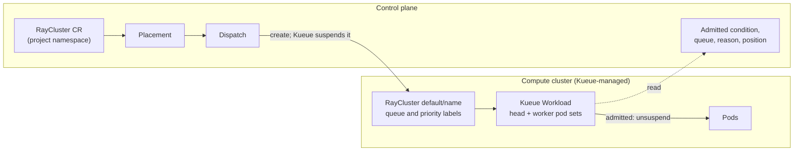

# RFC-20260731: Kueue Integration for Michelangelo Jobs

- **Status:** Draft
- **Author(s):** @dragod812
- **Created:** 2026-07-31
- **Revised:** 2026-10-26

---

## Summary

Michelangelo starts a Ray cluster as soon as the control plane dispatches it to a compute cluster. Nothing enforces a project's share of that cluster or orders the jobs that do not fit, and a Ray cluster whose workers cannot all be scheduled holds what it got while it waits for the rest.

Kueue solves these problems inside a Kubernetes cluster, and has built-in integrations for KubeRay and the Spark Operator. This RFC defines how Michelangelo integrates with it: what users and operators set and see, how the control plane labels, tracks and bounds a queued job, and a placement seam through which multi-cluster placement can later become a Kueue-aware scheduler or MultiKueue.

| Area | Decision |
|---|---|
| Division of labor | Kueue decides *when* a job starts and against which quota. Michelangelo decides *where* it runs, for which project, and at what priority. |
| Opt-in | Per compute cluster, through the existing `ClusterSpec.scheduler_type`. Other clusters behave as today. |
| Tenancy | The queue follows from the job's project. Users never name a queue. |
| User controls | An optional priority class per job. Status shows the queue, Kueue's reason for the wait, and the job's position. |
| Lifecycle | Waiting in the queue has its own status and its own bound. The provisioning budget starts at admission. The control plane enforces both and handles evictions. |
| Placement | Unchanged. A Kueue-aware scheduler or MultiKueue is built when a deployment needs one, after the evaluation below. |

It builds on [RFC-20260805](../20260805-compute-cluster-helm-chart/20260805-compute-cluster-helm-chart.md), which installs Kueue and the queue objects on compute clusters.

| Term | Meaning |
|---|---|
| Compute cluster | A Kubernetes cluster registered through a `Cluster` CR, to which the control plane dispatches workloads |
| Kueue-managed | A compute cluster whose `Cluster` CR sets `scheduler_type: SCHEDULER_TYPE_KUEUE` |
| Placement | Choosing a job's compute cluster, recorded in `status.assignment` |
| Dispatch | Creating the job's object on its compute cluster |
| Admission | Kueue reserving quota for the whole job and letting it start |
| LocalQueue / ClusterQueue | Kueue's namespaced queue, and the cluster-scoped quota pool it feeds |

## Problem statement

A Ray job on Michelangelo takes this path today:
1. Its `RayCluster` CR is created in its project's namespace on the control plane.
2. The scheduler places it on a compute cluster: the one named by the `michelangelo/cluster-affinity` label, or else any registered cluster, regardless of its load.
3. The RayCluster controller creates a KubeRay `RayCluster` on that cluster, in namespace `default`.
4. KubeRay creates all the pods at once, and kube-scheduler binds whichever fit.

On a shared cluster that leaves four gaps:
1. **No quota.** Nothing limits a project's share of a cluster, so one large job can take every GPU.
2. **No queue.** When a cluster is full, a job's pods sit `Pending` beside everyone else's, in no defined order.
3. **No all-or-nothing start.** A Ray cluster whose head is scheduled but whose workers are not holds GPUs while it waits, and two such clusters can block each other. The Ray task works around this by letting workers retry their connection to the head for about 30 minutes. Its readiness wait fails the task after 30 minutes, even when the cluster is only waiting its turn.
4. **No priority.** `SchedulingSpec.preemptible` is not enforced, and priority is an open TODO ([michelangelo#929](https://github.com/michelangelo-ai/michelangelo/issues/929)).

Main is partly ready. KubeRay's suspended state maps to a non-terminal `RAY_CLUSTER_STATE_SUSPENDED` ([michelangelo#1700](https://github.com/michelangelo-ai/michelangelo/pull/1700)), so a cluster held by an admission controller is not failed, and `ClusterSpec.scheduler_type` has a `SCHEDULER_TYPE_KUEUE` value that nothing reads yet. What is missing is the integration: who sets the queue, what users see while a job waits, how long it may wait, and what happens when Kueue takes resources back.

## Motivation

GPUs are the scarcest resource in a Michelangelo deployment, and the teams that share them need quota, ordering and all-or-nothing starts. Kueue, a Kubernetes SIG project, is an admission layer built for this: it decides when a workload may start and against which quota, and leaves pod placement to kube-scheduler. Composing with it gives Michelangelo quota, fair sharing and borrowing across teams, priority and preemption, and gang admission, without building any of them.

Choosing a cluster for each job is a separate problem, whose answer depends on the fleet. This RFC keeps placement behind its existing interface, so that a Kueue-aware scheduler or MultiKueue can be built later without changing how jobs are queued, labeled or reported.

## Goals

- **G1.** Opt-in per compute cluster. Clusters that are not marked run existing jobs exactly as today.
- **G2.** All-or-nothing, quota-checked admission for Ray clusters, through Kueue's built-in RayCluster integration. Michelangelo creates no Kueue `Workload` objects.
- **G3.** Tenancy from the project. The queue follows from the job's project, never from user input, and only the control plane sets Kueue labels or priority.
- **G4.** Visible queueing. API status, the CLI and the pipeline run view distinguish queued, provisioning and running, and show Kueue's reason for the wait.
- **G5.** A correct lifecycle: time in the queue never uses up the provisioning budget, both the time in the queue and each start are bounded, and evictions are handled and reported.
- **G6.** A priority per job, mapped to Kueue priority classes.
- **G7.** A placement seam. Queue resolution, labels and the `Admitted` condition do not depend on how a job's cluster was chosen, so a later placement strategy reuses them.
- **G8.** A defined path for Spark, once Spark jobs are dispatched to compute clusters.

## Non-goals

- **Building multi-cluster placement.** It is built when a deployment needs it, after the evaluation in "Placement and its evolution".
- **A Michelangelo API for quota.** ClusterQueues, cohorts, borrowing and preemption stay Kueue objects that operators own.
- **Per-project namespaces on compute clusters.** Every dispatched object goes to `default` today. The queue mapping moves with such a change, but the change is separate.
- **Gating RayJobs.** A Michelangelo RayJob runs on an existing RayCluster, which it selects through `clusterSelector`, and Kueue deliberately skips such RayJobs ([kueue#7218](https://github.com/kubernetes-sigs/kueue/pull/7218), from Kueue 0.15). Gating the RayCluster gates the work.
- **Autoscaling Ray clusters under Kueue, and topology-aware scheduling.** Each is its own decision.

## Design

### Division of labor



Michelangelo keeps its scheduler for placement, and Kueue on each compute cluster is the only admission authority. The contract between them is narrow: labels on the way in, `Workload` status on the way out. Michelangelo never creates, edits or deletes a `Workload`. Kueue's RayCluster integration derives it from the labeled RayCluster and deletes it with the RayCluster. Alternative A explains why Michelangelo's job queue is not replaced.

### Opting a cluster in

A cluster is Kueue-managed when its `Cluster` CR sets `scheduler_type: SCHEDULER_TYPE_KUEUE`. A change takes effect for the next job placed there, without a restart; today the control plane's cluster cache ignores changes to this field, and Phase 1 changes that. The control plane records the mode on each job after placement and before it creates the job's object: a job placed on a Kueue-managed cluster gets `status.admission`, and no other job does. A mode change therefore affects only jobs placed afterwards. Jobs already placed keep their mode, so an operator removes Kueue from a cluster only once every job placed there in Kueue mode has ended or been killed. A ready cluster holds its quota until it is deleted, so this does not happen on its own. A control-plane-wide switch would be simpler, but a fleet migrates one cluster at a time, and a mixed fleet has to work.

What the integration requires of a Kueue-managed cluster:

| Requirement | Why |
|---|---|
| Kueue 0.15 or later, serving `v1beta2` and managing `ray.io/raycluster` objects in `default`; KubeRay 1.1.0 or later | The RayCluster integration, which needs KubeRay 1.1.0, and the API version the control plane reads: Kueue serves `v1beta2` from 0.15, and stops serving `v1beta1` in 0.20. A job that Kueue does not manage fails (Dispatch). |
| `manageJobsWithoutQueueName: false`, Kueue's default | Only objects the control plane labels are queued. The RayJob's submitter pod and other unlabeled workloads run unmanaged. |
| `waitForPodsReady`, with a timeout longer than the provisioning budget | Quota admission does not guarantee that every pod fits on a node. Kueue evicts a workload whose pods are not all ready in time and releases its quota. With a longer timeout, the control plane's budget decides while the control plane runs, and Kueue's eviction is the backstop when it cannot act. Kueue 0.19 enables it by default, but its default 30-minute timeout equals the budget, so it must be raised. |
| `recoveryTimeout: 0s`, which turns off recovery eviction | By default Kueue evicts a cluster that stays not ready for the timeout after having been ready. KubeRay replaces a lost pod, whereas an eviction after `READY` fails the job (Lifecycle). |
| `ephemeral-storage` excluded from quota (`resources.excludeResourcePrefixes`) | Ray pods request ephemeral storage when a task sets a disk size, and Kueue never admits a workload that requests a resource its ClusterQueue does not cover. |
| A LocalQueue for each project allowed on the cluster | The tenancy mapping (next section) |
| Read access for the control-plane identity (APIs and CRDs) | The checks before dispatch, status, and queue position |

RFC-20260805's charts meet each requirement and pin a tested Kueue version. Their other settings confine Kueue's webhooks to `default`, which matters for availability, not for this RFC's behavior.

### Tenancy: which queue a job joins

A job's project is the namespace of its CR on the control plane, and creating a project binds its name to its namespace. No label or field lets a submitter reach another project's queue, so isolation is as strong as the control over who creates jobs in a namespace. Namespace-bound authorization ([enhancements#20](https://github.com/michelangelo-ai/enhancements/pull/20)) limits that to the project's members. Without it or an equivalent, anyone who can create a job in a namespace spends that project's quota, so teams should not share a Kueue-managed cluster until their deployment has one.

Compute-side objects are named after the job alone (`default/<job name>`), so jobs in two projects can share a name. From RFC-20260805's Phase A, the control plane neither adopts nor deletes a compute-side object that another project's job created, even one created before that phase, so no job can run on, or delete, a cluster charged to another project's queue.

The LocalQueue is `ma-<project>`, in `default`: the control plane creates every compute-side object there, and Kueue requires a LocalQueue to be in its workloads' namespace.
- **The `ma-` prefix** keeps a project from silently joining a LocalQueue that another tool created under the same name.
- **Long project names.** A label value holds at most 63 characters, so a project name longer than 60 is cut to its first 51 characters, followed by `-` and the first 8 hex digits of the SHA-256 of the full name. The job's status and the `QueueNotFound` message show the resolved name.
- **One fixed rule.** There is no per-deployment template and no override map, so the control plane, the queues chart and the documentation always agree on the name. To give a project different quota, an operator changes what its LocalQueue points at, not its name.
- **Operators create LocalQueues,** because choosing the ClusterQueue behind one is a quota decision. RFC-20260805's queues chart takes project names and applies this rule, so no one computes a queue name by hand. Whether onboarding a project should create its LocalQueue is an open question.

Quota policy stays in Kueue's terms. In the queues chart's default **shared pool**, every LocalQueue feeds one ClusterQueue: projects get queueing, ordering and gang admission, but no guaranteed share. For **quota per team**, a project's LocalQueue feeds its own ClusterQueue, in a cohort that lends idle capacity. The control plane needs only the LocalQueue's name either way. With per-project namespaces on compute clusters, the mapping would become "a LocalQueue in the project's namespace", and nothing else would change.

Users never choose a queue (Alternative B).

### Dispatch to a Kueue-managed cluster

Before dispatch, the control plane checks that the target has the project's LocalQueue and, if the job has a priority class, its WorkloadPriorityClass, and that it can read Workloads there. If a check fails, it does not create the object:
- the job stays placed but undispatched;
- its condition is `Admitted=False`, with reason `QueueNotFound` or `PriorityClassNotFound` and a message naming the cluster and the missing object, or `QueueCheckFailed` with the error when the control plane cannot read these objects;
- the check repeats until it passes or the configuration bound expires, and the job then fails with the same reason. The bound is one hour by default, not 24, because an operator must fix these errors, whereas quota frees up without anyone acting.

Kueue would accept such an object and leave it suspended. It reports a missing LocalQueue as `Inadmissible`, like a lack of quota, and for a missing WorkloadPriorityClass it creates no Workload at all, with no event before Kueue 0.20. Checking first costs a few reads, gives users one stable reason for the most common onboarding mistakes, and keeps objects that cannot run off the compute cluster.

The dispatched RayCluster carries two labels, and the control plane computes both:

| Label | Value |
|---|---|
| `kueue.x-k8s.io/queue-name` | `ma-<project>` |
| `kueue.x-k8s.io/priority-class` | The job's priority class, when it resolves to one (Priority) |

No user input reaches these labels. The control plane does not copy a job's labels or annotations to compute-side objects, as today. Pod templates are the remaining path, so the control plane fails a job whose pod templates set either of two things, instead of dispatching it to a Kueue-managed cluster:
- `kueue.x-k8s.io/` labels or annotations, which could choose a queue if the cluster later enabled another Kueue integration. Reason: `KueueLabelsNotAllowed`.
- A Kubernetes `priorityClassName`, which would order the queue when the job has no class, and would let kube-scheduler preempt admitted pods behind Kueue's back. Reason: `PodPriorityNotAllowed`.

Other clusters accept both, as today.

Kueue's webhook suspends the RayCluster when it is created. Kueue then builds a Workload with one pod set for the head and one for each worker group, and admits all of them together, or none.

A cluster whose Kueue does not manage RayClusters in `default`, such as one configured by hand, would instead let the object start at once, outside quota, and create no Workload for it. The control plane fails a job whose object it finds running with no Workload, and still finds without one on a fresh read a minute later, with reason `NotManagedByKueue`, and counts it in its failure metrics, so a misconfigured cluster fails loudly instead of silently bypassing quota. A Workload that exists but is not admitted, such as one that Kueue has just evicted, and a read that fails never count as a missing Workload; the check before dispatch confirms that Workloads can be read.

Two properties of Michelangelo's Ray clusters fit the RayCluster integration:
- **A fixed size.** The control plane does not enable KubeRay's autoscaling, so a cluster runs its head and `min_instances` workers, and Kueue charges and admits exactly that. Autoscaling under Kueue needs Kueue's elastic workloads, which this RFC does not take on.
- **The RayJob rides on the cluster.** It carries no label, and Kueue skips it because of its `clusterSelector`. Its small submitter pod runs outside quota, so operators sizing a ClusterQueue leave room for it.

Kueue's webhook sits in the create path, so a Kueue restart can briefly reject creates. RFC-20260805 runs it with two replicas, and its control plane retries transient create errors for up to ten minutes, so a restart delays dispatch instead of failing jobs.

### Lifecycle and time bounds

| Phase | What the user sees | Bound |
|---|---|---|
| Queued | `Admitted=False`, with reason `Pending` until Kueue reports its own. `state: SUSPENDED` once the object exists. | Admission bound: 24 hours by default, summed across waits |
| Provisioning | `Admitted=True`, `state: PROVISIONING` | Provisioning budget: 30 minutes by default, for each admission |
| Ready | `state: READY` | None. The cluster holds its quota until it is deleted. |

The control plane enforces both bounds, so they apply to every client, not only to pipelines. It records their clocks in `status.admission` (APIs and CRDs), so a control-plane restart neither resets nor extends them, and users can see how long a job has waited. Each bound is judged on freshly read status: a job found admitted is never failed for its wait, nor one found `READY` for its provisioning, however late the control plane finds out. A job whose status cannot be read is judged on its clocks. Today a cluster's state reads `UNKNOWN` from its first status read until `READY`, because KubeRay reports no state in between. On a Kueue-managed cluster the state tells queued from starting: `SUSPENDED`, then `PROVISIONING`. A provisioning cluster with a terminal pod error, such as a pod that cannot be created, fails at once, as a cluster in `UNKNOWN` does today, instead of holding its quota until the budget runs out. `Admitted` keeps its last value when a job ends, and every failure below deletes the job's compute-side object, as failing a job does today.
- **Admission bound.** Kueue sets no limit on how long a workload may wait, and a job that asks for more than its queue can ever admit would wait forever. The control plane fails a job whose time in the queue exceeds the bound, with reason `AdmissionTimeout`. The bound counts every wait, including those after evictions, so repeated preemption cannot keep a job alive indefinitely. The 24-hour default lets a busy queue drain overnight without letting a misconfigured job linger for days.
- **Provisioning budget.** Each admission must reach `READY` within the budget, 30 minutes by default and the Ray task's limit today, or the control plane fails the job with reason `ProvisioningTimeout`. A budget for each admission charges a job that is preempted while starting nothing for the start it lost, and time in the queue never counts.
- **The Ray task waits for the verdict.** Today the task deletes a cluster that is not ready 30 minutes after its creation, and fails. Once a job has `status.admission`, that limit stops applying, and the task waits until the control plane reports `READY` or a failure. No fixed limit fits that wait, because each admission after an eviction starts a new budget. The task gives up only when the control plane stops checking on the job: the control plane sets `status.admission.last_check_time` when it records the job's admission status, and refreshes it at least every five minutes until the job is `READY`, whether or not each check succeeds, and including before dispatch. The task deletes the cluster and fails once that time is 30 minutes old. Thirty minutes rides out a control-plane restart or a short outage, and refreshing only every five minutes keeps a long queue cheap. Jobs on other clusters keep today's limit, and so does a job that still has no `status.admission` after 30 minutes.
- **Evictions.** Kueue evicts an admitted workload, for example when a higher-priority workload preempts it (only where an operator enables preemption), when its pods miss the `waitForPodsReady` deadline, or when an operator drains its queue. Kueue suspends the RayCluster again, which deletes its pods, and the control plane copies Kueue's reason into `Admitted=False`. Then:
  - **Before `READY`,** the job is queued again. No work was lost.
  - **After `READY`,** the control plane fails the job with reason `Evicted`. A Ray cluster that lost its pods has lost its state and any RayJob running on it, and re-admitting it later would hold quota for an empty cluster. Resuming transparently would need checkpoint-aware resubmission, which is out of scope.
- **Deactivation.** Kueue deactivates a workload when it exhausts its `waitForPodsReady` requeues, when an admission check rejects it, or when an operator deactivates it. The control plane fails the job at once, with reason `AdmissionDeactivated`, instead of leaving it suspended until the bound.
- **Retries.** A Ray task with `retry_attempts` set (the default is 0) reruns a job whose cluster was evicted after `READY` on a fresh cluster, which queues like any other. As today, a cluster that never becomes ready fails the task without a retry.
- **Ready clusters keep their quota.** Kueue never treats a RayCluster as finished, so a cluster holds its quota until it is deleted. The Ray task deletes its cluster when its job ends, as today. A cluster created through the API keeps its quota until it is killed.
- **Kill and delete.** Killing a job deletes its compute-side object, and Kueue deletes the Workload, releasing any quota it held. On a Kueue-managed cluster, deleting the job's CR does the same. Today a deleted CR leaves its compute-side object behind, and a queued orphan would be admitted later and run with no owner.

### Priority

A job may name a priority class in a new optional field, `SchedulingSpec.priority_class`:
- The value must be one of the classes configured for the deployment, for example `low`, `normal` and `high`. Submission rejects any other value, so a typo fails at once, not at dispatch.
- A job that names no class gets the deployment's preemptible class if it sets `preemptible: true`, and otherwise the default class, if one is configured. `preemptible` is an API field; pipeline authors name a class instead.
- On a Kueue-managed cluster, the control plane stamps the class as `kueue.x-k8s.io/priority-class`. That names the Kueue `WorkloadPriorityClass` of the same name, which each Kueue-managed cluster defines; the queues chart renders the set. On other clusters the field has no effect.

Kueue orders a ClusterQueue by priority, then in arrival order, so priority changes the order of admission from the start. It never stops a running job unless an operator enables preemption on the ClusterQueue, and the eviction rules above cover that case. Each choice has a reason:
- **A Kueue `WorkloadPriorityClass`, not a Kubernetes `PriorityClass`.** Priority changes queue order without changing how kube-scheduler preempts pods.
- **A class name, not a number.** Priority values mean something only relative to one another within a deployment, so operators keep the values and users keep the names.

The field closes the priority TODO in `SchedulingSpec` (#929).

### Status and user interfaces

| Who | Sets | Sees |
|---|---|---|
| Pipeline author (Uniflow SDK) | `RayTask(priority_class="high")`, optional | A queued Ray task stays Pending in the pipeline run view, and its message follows the job: Kueue's reason, for example `Queued in ma-churn on gpu-1: waiting for quota (position 3)`, then `Provisioning Ray Cluster...` after admission. Today the message is set once and never changes. A failed task's message carries the control plane's reason. |
| API and CLI user | `spec.scheduling.priority_class` | `status.admission`: the queue, how long the job has waited, and its position; the `Admitted` condition's status, reason and message; `state: SUSPENDED` while queued |
| Operator | `scheduler_type` per cluster; LocalQueues and their ClusterQueues; the priority classes; preemption per ClusterQueue; the bounds | Metrics for admission waits, admissions, evictions and failures, by cluster and project. Quota usage stays in Kueue's own metrics. |

The `Admitted` condition:

| Status | Reason | Source |
|---|---|---|
| False | `QueueNotFound`, `PriorityClassNotFound`, `QueueCheckFailed` | The control plane, before dispatch |
| False | `Pending` | The control plane, from dispatch until Kueue reports on the Workload |
| False | Kueue's reason, for example `Pending`, `Inadmissible` or `UnsatisfiedAdmissionChecks` | Kueue has not admitted the workload. The reason and message are copied from its Workload, so newer Kueue versions show finer reasons, such as `WaitingForQuota`. |
| False | `Evicted` | Kueue evicted the workload. Its eviction reason, such as `Preempted` or `PodsReadyTimeout`, is in the message. |
| True | `Admitted` | Kueue admitted the workload. The message names the ClusterQueue and the resource flavors. |

`Enqueued`, `Scheduled` and `Launched` keep their meanings: the placement queue accepted the job, placement chose its cluster, and the object was created there.

**RayJobs.** The Ray task creates its RayJob once the cluster is `READY`, as today, so a queued job has no RayJob yet. A RayJob whose cluster is evicted fails with reason `Evicted`.

**Observing the job.** Today the control plane stops reading a RayCluster once it is `READY`. On a Kueue-managed cluster it follows the RayCluster, and the Workload that Kueue derives from it, until the job ends, because Kueue can evict a ready cluster. Status reflects an admission or an eviction within a minute. Hundreds of jobs may wait for hours, so observing a queued job must cost far less than observing one that is provisioning.

**Queue position (Phase 2).** Kueue's visibility API, on by default, lists the pending workloads of a LocalQueue with their positions in the LocalQueue and in its ClusterQueue. Status shows the ClusterQueue position, which decides the order of admission: in the default shared pool, a project's LocalQueue does not show the other projects' jobs ahead of it. Positions refresh about once a minute, at a cost that does not grow with the number of waiting jobs.

### Placement and its evolution

Placement and admission meet at three points, which any placement strategy must respect:
1. **One decision per job.** Placement returns one target and records it in `status.assignment`. The integration reads it and never derives it again.
2. **Admission follows the target.** The target's `scheduler_type` decides whether the job is queued. Its queue and priority come from the job, whichever cluster is chosen.
3. **Status comes from the target.** The control plane reads the object it dispatched, on the cluster it dispatched it to.

A queued job holds no pods and no quota, so a later strategy could move it to another cluster. Phase 1 never moves a job, and moving one needs more than deleting its object: a state that is not a failure (today a missing compute-side object fails the job), and confirmation that the old object is gone before the job is placed again, so that a late admission cannot run it twice.

Today's strategy, `cluster_only`, returns the cluster named by the affinity label, or else any registered cluster, regardless of its load or readiness. That suits deployments with one cluster per pool and pinned workloads, where Kueue queues each job on its cluster. A mixed fleet must pin every job by affinity, because an unpinned job can land on any cluster, Kueue-managed or not. Several Kueue-managed clusters that can serve the same jobs need real multi-cluster placement, which can come three ways:

| Option | How it places | What it adds to Phase 1 | Costs |
|---|---|---|---|
| **A. Kueue-aware scheduler** | Michelangelo ranks the clusters that carry the project's LocalQueue by their Kueue state: quota, usage and pending work. | A placement strategy and read access to ClusterQueues. Re-placing a job that waits too long also needs the rules for moving a job, above. | It decides from a snapshot. Without coordination, simultaneous decisions can all pick the same cluster that looks idle. |
| **B. MultiKueue** | The control plane dispatches to a MultiKueue manager cluster. Kueue offers the workload to worker clusters, and the first to admit it runs it. | A scheduler type for the manager, whose pods run elsewhere; the strategy returns the manager. MultiKueue copies the worker's status back to the manager's object, so the labels and the `Admitted` condition are unchanged. The control plane creates each RayJob on the admitting worker itself: Kueue skips RayJobs that use `clusterSelector`, so MultiKueue does not copy them. | A manager cluster holding credentials for every worker, each carrying the same LocalQueues. The control plane must learn the admitting worker from the manager's Workload, to submit jobs and read pods, logs and status there. MultiKueue supports RayCluster, but not SparkApplication. |
| **C. A Michelangelo dispatcher for MultiKueue** | As B, but a Michelangelo controller chooses the workers that MultiKueue tries | As B, plus that controller | As B |

Under all three, placement returns a target, and queue resolution, labels and the `Admitted` condition follow from it unchanged. Each option needs the control-plane work in its row, but none needs Phase 1 undone, so Phase 1 commits to none of them.

**Evaluation.** The choice is made in a follow-up RFC, when a deployment first needs multi-cluster placement. MultiKueue is evaluated first, on a manager cluster with two workers: it is beta, on by default, and maintained upstream, so adopting it costs less than building a scheduler. The criteria:

| Criterion | Question | Favors |
|---|---|---|
| Coverage | Does MultiKueue support every job type the control plane dispatches? Today it supports RayCluster, but not SparkApplication. | B or C if yes, A if not |
| Observability and submission | Can the control plane find the admitting worker, create RayJobs there, and read their pods, logs and status as reliably as today? | B or C if yes, A if not |
| Operations | Is a manager cluster with credentials for every worker acceptable for the deployment? | B or C if yes, A if not |
| Policy | Does placement need inputs that Kueue's dispatchers cannot express, such as data locality, cost or cluster tiers? | C or A if yes |
| Maturity | Does the deployment accept MultiKueue's beta status and, for C, an external-dispatcher path that Kueue does not yet document? | A if not |

A Kueue-aware scheduler is built only where MultiKueue fails a criterion that matters to the deployment.

### Spark

SparkJobs run today on the control-plane cluster, outside the scheduler. Once they are dispatched to compute clusters (a separate change), the same contract applies through Kueue's SparkApplication integration, which is alpha and sits behind the `SparkApplicationIntegration` feature gate. Spark adds five requirements:
- **Versions.** Kueue 0.19.9 or later on the 0.19 line (0.20.2 or later on 0.20), the first patches with all of Kueue's SparkApplication fixes, among them correct accounting of driver and executor requests. A Spark Operator release with `spec.suspend` (2.4.0 or later) that also stops executors on suspension: releases through 2.5.2 leave them running outside quota ([spark-operator#2961](https://github.com/kubeflow/spark-operator/issues/2961), fixed but not yet released). Phase 3 waits for that release.
- **SparkApplications in `default`,** where the project's LocalQueue is.
- **A fixed executor count.** Kueue sizes the workload from `executor.instances`, so executors beyond the admitted count would run outside quota. Kueue's webhook rejects the operator's `dynamicAllocation` field on a queued SparkApplication but does not inspect Spark properties, so the control plane rejects dynamic allocation set either way, at submission.
- **Memory in Spark's units.** Kueue accepts Spark memory only in Spark's units (`2g`, not `2Gi`), and charges each pod its memory overhead, at least 384 MiB, which ClusterQueues must leave room for.
- **Suspended means queued.** The SparkJob status mapping treats the operator's suspend states as queued, as the RayCluster mapping already does.

Placement, queue resolution, labels, the `Admitted` condition and the time bounds do not depend on the job type, so Spark adds no API.

## APIs and CRDs

**Proto changes (additive):**

```proto
message SchedulingSpec {
  bool preemptible = 1;
  // A priority class configured for this deployment. Empty means the
  // preemptible class when preemptible is true, and the default class otherwise.
  string priority_class = 2;
}

// Set once a job is placed on a Kueue-managed cluster, and never otherwise.
message AdmissionInfo {
  // The Kueue LocalQueue the job joins.
  string queue = 1;
  // Time in the queue during earlier waits, counted toward the admission bound.
  google.protobuf.Duration waited = 2;
  // When the current wait began: placement, or the latest eviction. Unset while admitted.
  k8s.io.apimachinery.pkg.apis.meta.v1.Time wait_start_time = 3;
  // When the current admission began. Unset while the job waits.
  k8s.io.apimachinery.pkg.apis.meta.v1.Time admission_time = 4;
  // The job's position in its ClusterQueue while it waits: 1 is next, 0 is unknown.
  int32 queue_position = 5;
  // When the control plane last checked on the job, before or after dispatch,
  // whether or not the check succeeded. Set when this status is first recorded,
  // and refreshed at least every five minutes until the job is ready.
  k8s.io.apimachinery.pkg.apis.meta.v1.Time last_check_time = 6;
}

message RayClusterStatus {
  // ... existing fields ...
  AdmissionInfo admission = 11;
}
```

`AdmissionInfo` sits beside `AssignmentInfo`, which keeps recording placement only, so each half of the division of labor has its own status. `SparkJobStatus` gets `admission` in Phase 3.

`ClusterSpec.scheduler_type` already exists. This RFC gives `SCHEDULER_TYPE_KUEUE` its meaning. `SCHEDULER_TYPE_INVALID` (unset) and `SCHEDULER_TYPE_DEFAULT` both mean "not Kueue-managed".

**Conditions.** A new condition type, `Admitted`, on RayCluster, with the reasons above; SparkJob gets it in Phase 3. New failure reasons on the existing `Succeeded=False` condition: `AdmissionTimeout`, `ProvisioningTimeout`, `AdmissionDeactivated`, `Evicted`, `NotManagedByKueue`, `KueueLabelsNotAllowed` and `PodPriorityNotAllowed`, and the three configuration reasons when the configuration bound expires.

**SDK and CLI.** `RayTask` gains `priority_class`. The Python bindings are regenerated, so the SDK and CLI show `SUSPENDED` by name instead of its number.

**Control-plane settings:**

| Setting | Default | Meaning |
|---|---|---|
| Admission bound | 24h | The longest a job may wait for admission, summed across waits |
| Provisioning budget | 30m | The longest an admission may take to reach `READY` |
| Configuration bound | 1h | The longest a job waits for a missing LocalQueue or WorkloadPriorityClass, or for a failed check to pass |
| Priority classes | None | The allowed values of `priority_class` |
| Default priority class | None | Applied to a job that names no class and is not preemptible |
| Preemptible priority class | None | Applied to a `preemptible: true` job that names no class |

With no classes configured, the control plane rejects any non-empty `priority_class` and stamps no priority label.

**Compute-side objects.** There are no new Michelangelo CRDs, and dispatched RayClusters carry the two labels above. Operators own LocalQueues, ClusterQueues, ResourceFlavors and WorkloadPriorityClasses, which RFC-20260805's queues chart renders. Kueue owns Workloads.

**Access the control-plane identity needs on a Kueue-managed cluster,** beyond its existing grants on KubeRay objects. All of it is read-only:

| Resource | Scope | Used for |
|---|---|---|
| `localqueues` | `default` | The check before dispatch |
| `workloads` | `default` | The check before dispatch, and status |
| `workloadpriorityclasses` | Cluster | The check before dispatch, from Phase 2 |
| Pending workloads of a LocalQueue (visibility API) | `default` | Queue position, from Phase 2 |
| `clusterqueues` | Cluster | Option A only |

## Alternatives considered

**A. Replace Michelangelo's job queue with a Kueue-backed one.** The scheduler extension guide sketches this: a `JobQueue` that turns each job into a Kueue `Workload`.
- *Pros:* one queue, with all scheduling behind one interface.
- *Cons:*
  - Michelangelo's queue chooses among clusters, while Kueue admits within one. Merging them makes placement a side effect of enqueueing.
  - Hand-built Workloads duplicate what Kueue's RayCluster and SparkApplication integrations already do: deriving pod sets, suspending, and reporting status.
  - A queue implementation is chosen once per control plane, which forces a fleet-wide switch.
- *Why not chosen:* admission belongs on the cluster that runs the pods, and placement belongs in the control plane.

**B. A queue chosen by the user,** through a job field or a task parameter.
- *Pros:* typed and discoverable. A team could split its work, for example into training and interactive.
- *Cons:* isolation becomes advisory, and validating each choice against an allowlist rebuilds the project mapping.
- *Why not chosen:* priority classes express urgency. Splitting a project's quota is an open question.

**C. Hold jobs in the control plane until a cluster has room.**
- *Pros:* nothing that cannot start is dispatched.
- *Cons:* it adds a second queue, which judges capacity from a snapshot, while Kueue admits against live quota and can preempt and borrow.
- *Why not chosen:* it rebuilds Kueue, and does it worse.

**D. One Kueue on the control-plane cluster, gating Michelangelo's CRs.**
- *Pros:* a single Kueue installation.
- *Cons:* it needs a custom Kueue integration for Michelangelo's CRDs, and quota would be tracked away from the pods, so `waitForPodsReady` and flavor assignment could not work.
- *Why not chosen:* quota is a property of each compute cluster.

**E. Volcano, YuniKorn or coscheduling.**
- *Pros:* mature gang scheduling, which KubeRay and the Spark Operator both support. YuniKorn has strong Spark support.
- *Cons:* Volcano and YuniKorn replace or run beside kube-scheduler, so each cluster runs and upgrades a second scheduler. Coscheduling has no quota.
- *Why not chosen:* Kueue composes with each cluster's existing scheduler, and covers quota, ordering and gang admission in one system.

## Open questions

- [ ] **LocalQueues created by the control plane.** Should onboarding a project create `ma-<project>` on the Kueue-managed clusters it may use, feeding a default ClusterQueue? That needs write access to LocalQueues on compute clusters.
- [ ] **Several queues per project.** Should a project be able to split its quota, for example into training and interactive, and let each job choose among the queues its project owns?
- [ ] **A bound per job.** Is the deployment-wide admission bound enough, or should a job be able to set a shorter one, so it fails fast and can be resubmitted elsewhere?
- [ ] **Asks that can never fit.** Should a job that asks for more than its queue can ever admit fail at once, rather than at the bound? From 0.20, Kueue reports such a workload with reason `ExceedsMaxQuota`, so the control plane could fail it on that reason.

## Rollout strategy

| Phase | Ships | Gate | Rollback | Done when |
|---|---|---|---|---|
| 1 | Opt-in without a restart; queue resolution and the checks before dispatch; labels; the `Admitted` condition and `status.admission`; observation until the job ends; the `SUSPENDED` and `PROVISIONING` states, with terminal pod errors failing a provisioning job at once; the bounds, with the Ray task waiting for the verdict and showing the job's status; eviction, deactivation and deletion handling; failing jobs that Kueue does not manage; metrics; the sandbox's Kueue mode | A cluster marked `SCHEDULER_TYPE_KUEUE` | Unmark the cluster. Placed jobs keep their mode; Kueue comes off once they have ended or been killed. | The Phase 1 e2e cases below pass |
| 2 | `priority_class` and the preemptible mapping; queue position | Priority classes configured | Remove the classes. Stamped jobs drain. | Priority orders the queue. With preemption enabled on a ClusterQueue, a high-priority job evicts a low-priority one that is not yet ready, which is queued again. |
| 3 | Spark through Kueue's SparkApplication integration | Ships with Spark dispatch to compute clusters and a Spark Operator release that stops executors on suspension; per cluster, with the feature gate | Unmark the cluster, drain held applications, then turn the gate off | A SparkApplication is held, admitted and succeeds; dynamic allocation is rejected |
| Later | Multi-cluster placement: a Kueue-aware scheduler or MultiKueue | A follow-up RFC, with the evaluation above | Per that RFC | Per that RFC |

- **Dependencies.** Phase 1 needs RFC-20260805's Phase A control plane, which retries transient create errors and never adopts or deletes another project's object, and its Phase B charts, which install Kueue and the queue objects. Both merge first; Phase B stays inert until Phase 1. Teams that share a Kueue-managed cluster also need namespace-bound authorization (Tenancy).
- **Backward compatibility.** No field is removed, every new field is optional, and clusters that are not marked run existing jobs as today. RFC-20260805's Phase A changes, its create retries and ownership checks, reach every cluster.
- **Migration.** A cluster whose `Cluster` CR already sets `SCHEDULER_TYPE_KUEUE` becomes Kueue-managed when Phase 1 ships. Create its LocalQueues before the upgrade, or its jobs wait with `QueueNotFound` and fail when the configuration bound expires.
- **Documentation.** Each phase's operator guide documents the cluster requirements, how to size quota (including the RayJob submitter pod), and how to read the `Admitted` condition.

**Phase 1 e2e cases,** on a Kueue-managed cluster unless stated otherwise:
- A pipeline job that does not fit waits longer than 30 minutes, then is admitted and succeeds.
- A project without a LocalQueue gets `QueueNotFound`, and its job runs once the queue exists, even 45 minutes later.
- A job evicted before `READY` is queued again; one evicted after fails with `Evicted`.
- A job whose pods never all start fails with `ProvisioningTimeout`; one whose pods cannot be created fails at once.
- A deactivated job fails with `AdmissionDeactivated`.
- A job whose pod template sets a Kueue label or a `priorityClassName` fails with `KueueLabelsNotAllowed` or `PodPriorityNotAllowed`.
- On a cluster whose Kueue leaves out RayClusters, a job fails with `NotManagedByKueue`.
- A Ray task fails 30 minutes after the control plane stops checking on its job.
- Deleting a queued job's CR removes its object.
- A control-plane restart resets neither bound.
- Marking and unmarking a cluster take effect without a restart.
- A job named like another project's job leaves that job's object untouched.
- On an unmarked cluster, existing jobs run as before.

## References

- [RFC-20260805: Compute Cluster Helm Charts](../20260805-compute-cluster-helm-chart/20260805-compute-cluster-helm-chart.md). It installs Kueue and the queue objects, grants the access listed above, retries transient create errors, and keeps the control plane off other projects' objects.
- [enhancements#20](https://github.com/michelangelo-ai/enhancements/pull/20) (RFC-20260807-oidc-k8s-rbac-auth): the namespace-bound authorization that tenancy relies on.
- [michelangelo#1700](https://github.com/michelangelo-ai/michelangelo/pull/1700): the non-terminal `RAY_CLUSTER_STATE_SUSPENDED`.
- [michelangelo#929](https://github.com/michelangelo-ai/michelangelo/issues/929): job priority.
- [kueue#7218](https://github.com/kubernetes-sigs/kueue/pull/7218): Kueue skips RayJobs that use `clusterSelector`, from 0.15.
- Kueue docs:
  - [RayCluster integration](https://kueue.sigs.k8s.io/docs/tasks/run/rayclusters/)
  - [SparkApplication integration](https://kueue.sigs.k8s.io/docs/tasks/run/kubeflow/sparkapplications/)
  - [Workload](https://kueue.sigs.k8s.io/docs/concepts/workload/)
  - [WorkloadPriorityClass](https://kueue.sigs.k8s.io/docs/concepts/workload_priority_class/)
  - [Preemption](https://kueue.sigs.k8s.io/docs/concepts/preemption/)
  - [waitForPodsReady](https://kueue.sigs.k8s.io/docs/tasks/manage/setup_wait_for_pods_ready/)
  - [Pending workloads on demand](https://kueue.sigs.k8s.io/docs/tasks/manage/monitor_pending_workloads/pending_workloads_on_demand/)
  - [MultiKueue](https://kueue.sigs.k8s.io/docs/concepts/multikueue/)
- [KubeRay with Kueue](https://docs.ray.io/en/latest/cluster/kubernetes/k8s-ecosystem/kueue.html)
