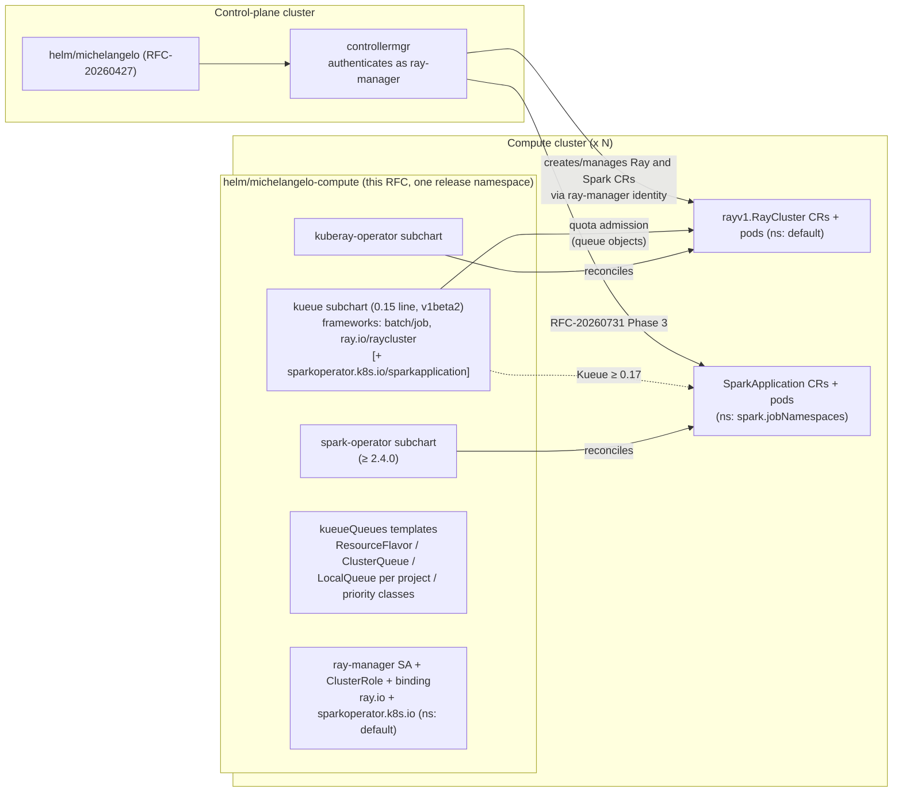
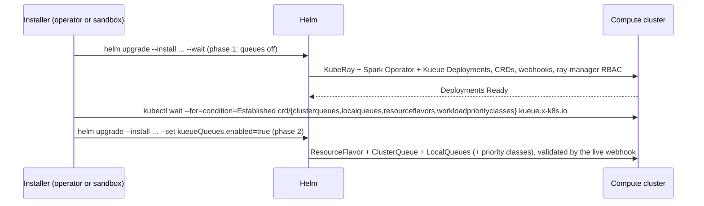

# RFC-20260805: Compute Cluster Helm Chart (`michelangelo-compute`)

- **Status:** Draft
- **Author(s):** @dragod812
- **Created:** 2026-08-05

---

## Problem statement

RFC-20260427 gave the Michelangelo **control plane** a Helm chart; the **compute side** still has none. Preparing a Kubernetes cluster to run Michelangelo batch workloads — Ray *and* Spark — today means assembling the pieces by hand:

1. **KubeRay operator** — installed imperatively by the sandbox (`helm install kuberay-operator ... --version 1.4.2`) with the version pinned inside Python code.
2. **Spark Operator** — installed imperatively by the sandbox (`helm upgrade --install spark-operator spark-operator/spark-operator`) with **no version pin at all**, and only on the control-plane cluster. A dedicated compute cluster provisioned by `--create-compute-cluster` gets KubeRay, a ConfigMap and a credentials Secret, and no Spark Operator — so today a compute cluster is a Ray-only target.
3. **Control-plane identity RBAC** — the `ray-manager` ServiceAccount + ClusterRole + ClusterRoleBinding the control plane authenticates as, `kubectl apply`'d from a raw manifest buried in `python/michelangelo/cli/sandbox/resources/`. Its comment says "ClusterRole for Spark/Ray jobs across namespaces"; its rules grant `ray.io` only.
4. **Kueue** — since [michelangelo#1985](https://github.com/michelangelo-ai/michelangelo/pull/1985) the control plane has an opt-in Kueue admission backend, and the operator guide asks operators to `helm install kueue` on each Kueue-managed cluster and `kubectl apply` a ClusterQueue plus one LocalQueue per project by hand; the sandbox scripts the same sequence for k3d (`ma sandbox demo kueue`).
5. **Manual doc steps** — the compute-cluster registration guide walks the same objects by hand for non-sandbox clusters, as a parallel implementation that can (and has) drifted from what the sandbox actually does.

The compounding symptoms:

- **No versioned install unit.** There is no artifact an operator can `helm install`, `helm upgrade`, diff, or roll back on a compute cluster. Upgrading means "re-run the right commands in the right order" — and for the Spark Operator, whatever version the chart repo serves that day.
- **No home for new per-cluster components.** Kueue adds an operator Deployment, a manager `Configuration`, and queue custom resources with a webhook-ordering constraint to every Kueue-managed cluster; RFC-20260731's Spark phase adds a Spark Operator version floor and a service-account contract. Sequencing that imperatively per cluster multiplies the fragility.
- **Adopters fork.** With no chart to install, anyone running Michelangelo on their own compute clusters ends up writing one — an umbrella chart with KubeRay, Spark Operator and Kueue subcharts, control-plane identity RBAC, and chart-templated queue objects. That work is identical for every adopter, and none of it flows back.

## Motivation

Two forcing functions arrived together. The Kueue backend on `main` expects each Kueue-managed compute cluster to carry Kueue, a ClusterQueue, and per-project LocalQueues in a fixed namespace, with ordering dependencies and per-cluster configuration (quotas); and RFC-20260731 extends the same stack to multi-cluster placement and to Spark, where the Spark Operator's version and service-account naming become part of the contract. Packaging all of it once, declaratively, is strictly cheaper than teaching the sandbox, the docs, and every adopter's provisioning pipeline the same sequence independently.

The pattern is well established — an umbrella chart is how a Kubernetes platform normally ships a set of components that must be installed together, in order, with per-cluster configuration. Providing one removes the incentive for per-adopter forks and completes the symmetry started by RFC-20260427 — one chart per cluster role:

| Cluster role | Chart | RFC |
|---|---|---|
| Control plane | `helm/michelangelo` | RFC-20260427 |
| Compute | `helm/michelangelo-compute` | this RFC |

Because the sandbox provisions its compute clusters through the same chart, the artifact operators install is exercised end-to-end by CI and by every developer sandbox — sandbox, docs, and production converge on one definition of "a Michelangelo compute cluster."

## Goals

- Two `helm upgrade --install` commands prepare any Kubernetes ≥1.27 cluster as a Michelangelo compute target for **both Ray and Spark**: KubeRay operator, Spark Operator, Kueue with the RayCluster (and, where supported, SparkApplication) integration, the cluster's queue objects, and the control-plane identity RBAC.
- The sandbox provisions every compute cluster (and the control-plane cluster when it doubles as one) through the chart — no raw compute-side manifests left in `sandbox.py`'s resources, and no unpinned operator installs.
- Default rendering is behavior-identical to the manifests and imperative installs it replaces (field-for-field, apart from standard chart labels), so existing sandboxes see no change.
- The values operators actually need are first-class: queue names and quotas (`kueueQueues.*`), the per-project LocalQueue list, the Spark job namespaces and service-account name, and subchart toggles (`kuberay-operator.enabled`, `spark-operator.enabled`, `kueue.enabled`) for clusters where an operator is already managed out-of-band.
- A CI gate lints and template-renders every supported profile on every chart change.

## Non-goals

- **Registration glue.** Minting the `ray-manager` token, and creating the `Cluster` CR (including its `scheduler_type`) plus the per-cluster CA/token Secrets **on the control plane**, stays in the operator guide. This boundary does *not* cleanly cover the object-storage credentials that Ray and Spark pods consume **on the compute side**; see Cross-cluster coupling below, which is unresolved.
- **The NVIDIA GPU stack.** Drivers, device plugin, and MIG tooling are cluster infrastructure (e.g. the NVIDIA GPU Operator), not chart contents.
- **Serving/online workloads and control-plane components** — batch (Ray and Spark) only; the control plane is RFC-20260427's chart.
- **Queueing and placement semantics.** What Kueue does, how the control plane resolves a project to a LocalQueue, and Kueue-aware assignment are RFC-20260731's (and michelangelo#1985's) scope; this RFC covers only how the cluster-side pieces are packaged and installed.
- **Publishing the chart to a registry** (install-from-source for now; see Open questions).

## High-level architecture



### Chart layout

```
helm/michelangelo-compute/
├── Chart.yaml              # kuberay-operator + spark-operator + kueue dependencies (condition-gated)
├── Chart.lock              # committed; charts/*.tgz resolved at install time
├── values.yaml
├── README.md               # install + full values table + version floors
└── templates/
    ├── _helpers.tpl
    ├── NOTES.txt            # per-component status, phase-2 reminder, verify commands
    ├── rbac/
    │   └── ray-manager.yaml # SA + ClusterRole + ClusterRoleBinding (rayManager.create)
    └── kueue/
        ├── resource-flavor.yaml     # all gated by kueueQueues.enabled
        ├── cluster-queue.yaml
        ├── local-queues.yaml        # one LocalQueue per kueueQueues.localQueues entry
        └── priority-classes.yaml    # optional WorkloadPriorityClass set
```

Subcharts are declared with `condition:` flags and resolved via `--dependency-update` (the `Chart.lock` is committed; tarballs are not vendored). Pins:

- **kuberay-operator** — `1.4.2`, the version the sandbox installs imperatively today, now declared in one place. Note the skew worth closing: the control plane already builds against `ray-operator` Go types `v1.5.0`, while the sandbox runs operator `1.4.2` and the chart line is at `1.7.x`. The chart pin should track the Go types' minor, with the bump landing as a normal chart-version change rather than a Python edit.
- **spark-operator** (Kubeflow, `https://kubeflow.github.io/spark-operator`) — pinned to a released `2.x` chart, **≥ 2.4.0** because that release added `spec.suspend`, which Kueue's SparkApplication integration requires. Today the sandbox pins nothing.
- **kueue** (`oci://registry.k8s.io/kueue/charts`) — the **0.15 line**, the first that serves `kueue.x-k8s.io/v1beta2` and the version `ma sandbox demo kueue` already installs. Note the version string carries **no `v` prefix**: the OCI registry publishes `0.15.0`, and `--version v0.15.0` fails to resolve; declaring the pin in `Chart.yaml` retires that footgun.

#### Kueue version floor, not pin exit plan

An earlier draft of this RFC pinned Kueue to `0.10.6` (serving `v1beta1`) because the control plane was expected to vendor a `sigs.k8s.io/kueue` Go client, whose version is tied to the repo's `k8s.io/*` libraries — and then spent a section on how to escape that pin. That constraint no longer exists. The backend that landed in michelangelo#1985 talks to Kueue with a raw `GET` against `kueue.x-k8s.io/<apiVersion>` (default `v1beta2`, configurable as `jobs.scheduler.kueue.apiVersion`), and RFC-20260731's informers keep the same property through the dynamic client. The control plane pins no Kueue module, so the chart's Kueue version is a compute-side decision made on compute-side grounds:

- **Floor: 0.15.** First release serving `v1beta2` (upstream has deprecated `v1beta1` and is retiring it in the 0.20 line), and it carries the RayJob `clusterSelector` skip ([kueue#7218](https://github.com/kubernetes-sigs/kueue/issues/7218)) that both this chart's `frameworks` narrowing and the control plane's "never label RayJobs" rule rely on.
- **0.17+ for Spark gating.** Kueue's `sparkoperator.k8s.io/sparkapplication` integration arrived in 0.17 behind the alpha `SparkApplicationIntegration` feature gate; RFC-20260731's Phase 3 needs it. The chart exposes the gate and the framework entry as values; below 0.17 they are simply absent and Spark on that cluster is admitted immediately.
- **Cadence.** Track the newest 0.x line that has a patch release, bumping as an ordinary chart change; adopters already running a newer Kueue set `kueue.enabled=false` and take the operators, RBAC, and queue objects from this chart — which the subchart toggles permit, and which is the interim answer for any pin.

### Values interface

```yaml
rayManager:                       # identity the control plane uses on this cluster
  create: true                    # false if managed out-of-band
  serviceAccountName: ray-manager # name is registration-facing; kept for continuity
  namespace: default              # must match where the control plane creates Ray resources
  clusterRoleName: ray-manager
  clusterRoleBindingName: ray-manager-binding
  grants:
    ray: true                     # ray.io: rayclusters, rayjobs
    spark: true                   # sparkoperator.k8s.io: sparkapplications (RFC-20260731 Phase 3)

kuberay-operator:
  enabled: true                   # false when the operator is already on the cluster
  # any upstream kuberay-operator chart value nests here

spark-operator:
  enabled: true
  spark:
    jobNamespaces: ["default"]    # every namespace SparkApplications are created in; "" = all
    serviceAccount:
      name: spark-operator-spark  # pinned: the control plane hardcodes this driver SA name

kueue:
  enabled: true
  managerConfig:
    controllerManagerConfigYaml: |-   # full Configuration override; the intentional change
      ...                             # vs upstream defaults is integrations.frameworks,
                                      # narrowed to ["batch/job", "ray.io/raycluster"]
                                      # (+ "sparkoperator.k8s.io/sparkapplication" on ≥ 0.17)

kueueQueues:
  enabled: false                  # phase-2 gate — see two-phase install below
  flavorName: default-flavor
  clusterQueueName: cluster-queue
  quota:                          # keys also derive the ClusterQueue's coveredResources
    cpu: 16
    memory: 32Gi
    nvidia.com/gpu: 4
  localQueueNamespace: default    # where the control plane dispatches workloads (RayLocalNamespace)
  localQueues: []                 # one per project, e.g. ["ma-california-housing", "ma-bert-cola"]
  priorityClasses: []             # optional WorkloadPriorityClass set, e.g. [{name: high, value: 1000}]
```

Six contract details worth calling out:

- **`kueueQueues.quota` keys derive `coveredResources`.** Adding a key both covers and quotas that resource; a workload requesting an uncovered resource stays suspended. Deriving one list from the other keeps them impossible to de-sync.
- **Partial quota overrides compose.** Helm deep-merges user values over defaults, so `--set kueueQueues.quota.cpu=64` (or a `-f` values file) changes CPU while memory/GPU keep chart defaults — the mechanism RFC-20260731's multi-cluster sandbox uses for per-cluster quotas.
- **Dotted resource keys need escaping with `--set`.** Helm reads `.` as a path separator, so `--set kueueQueues.quota.nvidia.com/gpu=8` silently builds a nested `nvidia: {com/gpu: 8}` map and leaves the real GPU quota at its default. The accelerator key must be escaped (`--set 'kueueQueues.quota.nvidia\.com/gpu=8'`) — which is why the sandbox passes per-cluster quotas as a generated `-f` values file rather than `--set`, and why operators should prefer values files too.
- **LocalQueues are a list, named by the control plane's convention.** The Kueue backend resolves a job's project to `ma-{project}` (`jobs.scheduler.kueue.localQueueTemplate`) and validates that queue exists in the dispatch namespace before dispatch. The chart therefore renders one LocalQueue per `kueueQueues.localQueues` entry, all in `localQueueNamespace`, all pointing at the cluster's ClusterQueue. An empty list is valid: it means per-project queues are authored elsewhere — for example the per-project LocalQueue reference that RFC-20260731 places next to each project's `project.yaml` in `michelangelo-examples`. Either path produces the identical object.
- **The Spark service-account name is a cross-chart contract.** The upstream chart names the driver ServiceAccount `<release>-spark`, which is `spark-operator-spark` only when the release is literally named `spark-operator` — and the control plane hardcodes that name on every SparkApplication it creates. Under an umbrella release the name would silently change, so the chart pins `spark.serviceAccount.name`. Likewise the operator reconciles SparkApplications only in `spark.jobNamespaces`, and the control plane creates them in the job's own namespace, so that list must cover every project namespace that runs Spark (or be `[""]` for all).
- **The `frameworks` override narrows the upstream default; it does not extend it.** Upstream's 0.15 chart enables twelve integrations out of the box (`batch/job`, `ray.io/raycluster`, `ray.io/rayjob`, `jobset`, `trainjob`, `appwrapper`, and six Kubeflow v1 kinds). Setting `frameworks: ["batch/job", "ray.io/raycluster"]` therefore *disables* ten of them — deliberately, because Kueue should only gate workload kinds the control plane stamps the queue label on, and each enabled framework costs a webhook and controller on every compute cluster. `ray.io/rayjob` in particular stays off: the control plane never labels RayJobs (michelangelo#1985), and Kueue skips `clusterSelector` RayJobs regardless. The Spark framework is added by the same value when the cluster meets the 0.17 floor.

### Two-phase install

Kueue's queue objects are custom resources validated by Kueue's own webhook, so a fresh install cannot create the operator and the queue objects in one release pass — the CRDs must be established and the webhook serving first. Rather than hiding this in hooks, the chart makes it an explicit gate (`kueueQueues.enabled`, default `false`):



The explicit `kubectl wait` exists because Helm's `--wait` only covers the Deployments, not CRD establishment. Both phases are idempotent `helm upgrade --install` calls; re-running either is safe. Adding a project later is a phase-2 re-run with one more `localQueues` entry.

### Namespace and lifecycle consequences

Two properties of the upstream Kueue chart shape how this one behaves in production; both hold on the 0.15 line (CRDs under `templates/crd/`, namespaced references through `.Release.Namespace`).

**One release namespace for three operators.** None of the three subcharts offers a namespace override, so an umbrella release installs KubeRay, the Spark Operator, and Kueue into the release namespace. The chart keeps `ray-system` as the default for continuity with the registration guide and every existing sandbox; the cost is muscle memory, since Kueue's docs (and the merged operator guide and `ma sandbox demo kueue`) say `-n kueue-system` and the Spark Operator's say `-n spark-operator`, so those commands come back empty here. NOTES.txt prints namespace-correct verify commands, and the operator guides should use the release namespace throughout. Operators who need the upstream layout set the corresponding subchart `enabled=false` and install it standalone.

**Kueue's CRDs are release-managed, which cuts both ways.** The chart ships its CRDs in `templates/crd/` rather than Helm's special `crds/` directory:

- *Upside:* `helm upgrade` reconciles CRD schema changes like any other manifest, so this chart avoids the standard Helm trap where `crds/` is install-only and silently drifts across upgrades. A Kueue minor bump is a normal chart upgrade.
- *Downside:* `helm uninstall` **deletes the CRDs**, and deleting a CRD cascades to every object of that kind. Uninstalling on a live cluster removes every `Workload`, `ClusterQueue`, and `LocalQueue` on it, discarding admission state for running jobs. Uninstall is a cluster-drain operation, not a no-op — see Rollback.

The Spark Operator subchart ships a mutating webhook (enabled upstream by default) that the Kueue SparkApplication integration also depends on for suspend/resume; it is left enabled.

### Cross-cluster coupling: object-storage credentials

One compute-side dependency does not fit the "chart prepares the compute side, guide does the registration" split cleanly, and it is worth resolving before this chart is called complete.

Ray log persistence is **on by default** (`controllermgr.jobs.k8sengine.mapper.logPersistence.enabled: true` in the control-plane chart). When enabled, controllermgr injects a `kuberay-collector` sidecar into every RayCluster head and worker pod, and that sidecar reads its S3 credentials through a `secretKeyRef`:

```yaml
# rendered by controllermgr into every Ray pod, on the COMPUTE cluster
env:
  - name: AWS_S3ID
    valueFrom:
      secretKeyRef:
        name: <controllermgr's jobs.k8sengine.mapper.logPersistence.credentialsSecret>
        key: AWS_ACCESS_KEY_ID       # and AWS_SECRET_ACCESS_KEY for AWS_S3SECRET
```

`credentialsSecret` defaults, control-plane-side, to `michelangelo.objectStorageSecretName` — `<release>-object-storage-credentials` — and the Secret of that name is templated by **`helm/michelangelo`**, so it exists only where the control-plane release is installed. A `secretKeyRef` is a *local* object reference: it resolves in the Ray pod's own namespace, on the compute cluster. The consequences:

- **Single-cluster sandbox:** works, but only coincidentally — control plane and compute cluster are the same cluster and namespace, so the Secret happens to be present.
- **Dedicated compute cluster:** nothing provisions it. `_create_compute_cluster` creates a Secret named `aws-credentials` with a single opaque `credentials` key (AWS-CLI ini format) — a different name *and* a different key shape — plus a `michelangelo-config` ConfigMap that Ray pods `envFrom`. Every Ray pod therefore fails with `CreateContainerConfigError` and never starts.

Spark widens the same gap: driver and executor pods read S3 through Hadoop's credential chain and the same `michelangelo-config` endpoint, so a Spark-capable compute cluster needs the same two objects. This is a name contract spanning two charts on two clusters, with the producer on one side and the consumer on the other. The compute chart is the only compute-side artifact in the design, which makes it the natural owner — templating an `objectStorage.credentials` Secret and the `michelangelo-config` ConfigMap next to `rbac/ray-manager.yaml`, keyed `AWS_ACCESS_KEY_ID`/`AWS_SECRET_ACCESS_KEY`, with the name defaulted to match controllermgr's default and overridable for operators who set `credentialsSecret` explicitly. Whether the chart should own it, or whether log persistence should be documented as opt-in for multi-cluster installs, is an Open question — but the current split leaves a default-on configuration broken on exactly the topology this chart exists to serve.

### Sandbox integration

`sandbox.py` replaces its imperative KubeRay and Spark Operator installs and raw RBAC/queue manifests with one code path that runs both phases (with the CRD wait between them) against a named cluster:

- **Dedicated compute clusters** (`--create-compute-cluster`): every provisioned cluster gets the full chart — for the first time including the Spark Operator; per-cluster `--compute-cluster-quotas` overrides and the demo project's LocalQueue ride phase 2 as a generated values file. `ma sandbox demo kueue` becomes "mark the Cluster CR" only, since the install is already done.
- **Control plane doubling as the compute cluster** (default single-cluster sandbox): the chart installs with `kuberay-operator.enabled=false` (the sandbox already installs the operator there with its local image imports) and the Spark Operator either from the chart or toggled off if the existing install is kept; the chart contributes Kueue, the queue objects, and the RBAC.

### Design choices worth naming

A few shapes in the values interface are deliberate rather than incidental, and are the places most likely to change as the platform grows:

- **One explicit `ray-manager` ClusterRole**, rather than binding an upstream aggregate role such as `edit`. The grant a compute cluster hands the control plane should be readable in one file and auditable by the operator installing it. The name predates Spark and is kept because registration tooling and docs reference it; the `grants` toggles say what it actually covers.
- **LocalQueue per project, resolved by the control plane.** The chart renders whatever list it is given and never invents a queue; the naming convention belongs to the control plane (`localQueueTemplate`), and the list of projects belongs to whoever onboards projects. This is why an empty list is a valid, non-broken default.
- **One `localQueueNamespace`**, because the control plane creates Ray resources in a single fixed namespace today. Multi-namespace is an Open question, and the schema is designed to grow into it (Spark already needs `spark.jobNamespaces`, which is the same list from the other side).
- **Quota defaults that actually admit** (cpu 16 / memory 32Gi / gpu 4) so a fresh sandbox runs a workload without tuning. Production installs are expected to override `kueueQueues.quota` with values sized to real capacity — inert or zero defaults would make the sandbox path silently non-functional.

## APIs and CRDs

No new CRDs, protos, or service APIs. The chart's public surface is:

- **The values interface above** — the operator contract for queue names, quotas, the LocalQueue list, identity names and grants, Spark namespaces and service account, and subchart toggles.
- **Rendered objects.** The `ray-manager` SA/ClusterRole/ClusterRoleBinding render field-for-field identical to the raw manifest they replace (plus standard chart labels and, when `grants.spark` is on, the `sparkoperator.k8s.io` rule), and the queue objects render exactly the `ResourceFlavor`/`ClusterQueue`/`LocalQueue` contract documented in RFC-20260731 and the merged operator guide.
- **CI contract.** A lint-and-render gate on every chart change: `helm dependency update`, `helm lint`, and template renders asserting that the default profile renders the identity, that disabling all three subcharts still renders the RBAC and no Deployment, that `kueueQueues.enabled=true` with a two-entry `localQueues` list renders the flavor, the ClusterQueue and both LocalQueues, and that the default profile renders none of them.

## Alternatives considered

### Alternative A: keep imperative installs (status quo)
**Pros:** no new artifact; sandbox already works.
**Cons:** no versioned unit, no upgrade/rollback, no operator-facing install; the Spark Operator floats unpinned; every new per-cluster component extends a Python-encoded sequence that docs must mirror by hand.
**Why not chosen:** fails the single-artifact goal, and Kueue plus Spark would triple the imperative surface.

### Alternative B: no umbrella chart — document the upstream charts plus a tiny RBAC-only chart
**Pros:** minimal code owned; upstream charts consumed directly.
**Cons:** operators hand-compose four installs with an ordering constraint between two of them and a naming contract between two others; no single version pin ties "a Michelangelo compute cluster" together; the queue objects and manager `Configuration` still need to live somewhere, which recreates the umbrella chart in documentation form.
**Why not chosen:** the composition and its ordering *are* the product; an umbrella chart is the standard Helm mechanism for exactly this.

### Alternative C: fold compute-side objects into `helm/michelangelo`
**Pros:** one chart to maintain.
**Cons:** the two charts install into different clusters with different cardinalities (one control plane, N compute clusters) and different lifecycles; a combined chart forces every compute value through the control-plane release and breaks RFC-20260427's deliberate "control plane only" boundary.
**Why not chosen:** cluster role is the natural chart boundary; the default sandbox (one cluster playing both roles) is handled by installing both charts on it.

### Alternative D: single-phase install via a Helm post-install hook Job
**Pros:** one `helm install`; no phase-2 command to forget.
**Cons:** the hook Job needs a kubectl image, its own RBAC, and in-cluster retry logic to wait out CRD establishment and webhook readiness; failures surface as opaque hook timeouts; hook-created resources sit outside normal release rendering (skipped by `helm template`/diff tooling).
**Why not chosen:** two idempotent `helm upgrade` calls with an explicit `kubectl wait` between them are simpler, debuggable, and CI-testable; NOTES.txt prints the phase-2 command after phase 1 so it is hard to forget.

### Alternative E: a Ray-only chart, with Spark packaged separately later
**Pros:** smaller first chart; Spark's compute-cluster dispatch is not built yet.
**Cons:** the Spark Operator is already part of every sandbox and the identity's stated scope; leaving it out ships a compute cluster that cannot run half of Michelangelo's batch workloads, and the service-account and namespace contracts are cheapest to fix while the chart is new.
**Why not chosen:** the stack is Ray *and* Spark; the chart should say so from its first version even where the control-plane side arrives in a later RFC phase.

## Open questions

- [ ] **Chart publishing.** The chart installs from a repo checkout today. Publish to an OCI registry (e.g. GHCR) and Artifact Hub? And what chart-version cadence relative to `appVersion` — the same question RFC-20260427 left open for the control-plane chart; the two should get one answer.
- [ ] **Token Secret template.** Registration needs the `ray-manager` ServiceAccount's token copied to the control plane, which today is a manual step in the operator guide. Should `rayManager` grow an optional `createTokenSecret` that renders the `Secret` so bootstrap can read it off the cluster, or does the token belong strictly to the registration flow?
- [ ] **Multi-namespace workloads.** When the control plane can create Ray resources in more than one namespace, `localQueueNamespace` and `spark.jobNamespaces` become one `workloadNamespaces` list (LocalQueue per project per namespace, optional namespace creation). Worth designing the values schema for that now, since it is a breaking shape change later.
- [ ] **Where LocalQueues are authored.** The chart list and the per-project reference in `michelangelo-examples` produce the same object; is carrying both worth it, or should fleets standardize on one (chart for centrally managed projects, per-project YAML for self-service onboarding)?
- [ ] **Kueue floor and Spark gate.** Is 0.15 the right floor, and should the chart default the `SparkApplicationIntegration` gate on as soon as the pinned Kueue supports it, or leave Spark gating opt-in until the integration leaves alpha?
- [ ] **Who owns the object-storage credentials Secret and `michelangelo-config`?** Should the chart template them (defaulting the Secret name to controllermgr's `<release>-object-storage-credentials`, accepting the cross-chart name coupling), should controllermgr stop defaulting the name and require it be set per cluster, or should log persistence default to off for multi-cluster installs? See Cross-cluster coupling — as it stands, a dedicated compute cluster cannot start a Ray pod with default settings.
- [ ] **Compute-cluster observability.** The chart installs three controllers that export Prometheus metrics (`kueue-controller-manager`, `kuberay-operator`, `spark-operator-controller`), but nothing on a compute cluster scrapes them, and queue-state visibility today is `kubectl get/describe clusterqueue`. Should the chart ship ServiceMonitors behind a `metrics.serviceMonitor.enabled` toggle, or does per-cluster monitoring belong entirely to the operator's own stack?
- [ ] **Guarding CRD deletion.** Because Kueue's CRDs are release-managed, `helm uninstall` cascades into every `Workload` and queue object on the cluster. Should the chart stamp `helm.sh/resource-policy: keep` on the queue CRDs (safer uninstall, but leaves orphaned CRDs behind and complicates a genuine teardown), or is documenting uninstall as a drain operation sufficient?
- [ ] **GPU install notes.** Add a `gpu.enabled`-style NOTES block (device-plugin verification, taints/tolerations gotchas for Ray and Spark pods) without taking on the NVIDIA stack itself?

## Rollout strategy

### Phase A — chart with KubeRay, Spark Operator and RBAC
`helm/michelangelo-compute` skeleton: kuberay-operator and spark-operator subcharts with their pins, `ray-manager` RBAC templates with the `grants` toggles, NOTES/README. Sandbox rewired to install the chart on every compute cluster (raw `rbac-ray.yaml` deleted, imperative operator installs removed); the operator guide's setup step becomes the chart install. CI lint/render gate added.
**Backward compatibility:** rendered defaults are field-identical to the replaced manifests apart from chart labels; the Spark Operator lands on dedicated compute clusters for the first time but reconciles nothing until the control plane dispatches there; sandbox CLI flags are unchanged.

### Phase B — Kueue subchart and queue objects
Kueue 0.15-line subchart with the narrowed manager `Configuration`; `kueueQueues.*` templates — flavor, ClusterQueue, LocalQueue list, optional priority classes — behind the phase-2 gate; sandbox runs both phases with the CRD `kubectl wait` between them and folds `ma sandbox demo kueue`'s install into it. Per-cluster quota overrides arrive as phase-2 values (consumed later by RFC-20260731's multi-cluster sandbox).

**Sequencing note.** Installing Kueue via this chart is safe on its own: the control plane stamps `kueue.x-k8s.io/queue-name` only on clusters whose `Cluster` CR carries `scheduler_type: SCHEDULER_TYPE_KUEUE` *and* only when `jobs.scheduler.backend: kueue` is set, and with `manageJobsWithoutQueueName` at its default `false` Kueue observes and admits nothing else. The moment a cluster is marked, RayClusters begin getting suspended, and suspension at any queue depth is only survivable once RFC-20260731's **Phase 0** (the creation-budget split) is in place. Phase B may therefore land before it, but marking production clusters should not. The operator guide should carry the same warning.

### Rollback
Each phase is independently revertible; reverting Phase A returns the sandbox to the raw-manifest path.

Operationally the release is reversible, but reversal is **destructive on a live cluster** and the blast radius grows with each step — everything here is release-managed, so unwinding deletes objects rather than orphaning them:

| Action | Effect | Safe when |
|---|---|---|
| `helm rollback` to a prior revision | Re-applies that revision's objects; quota values and the LocalQueue list revert | Anytime — quota changes only re-gate *future* admissions; a removed LocalQueue strands that project's new jobs at validation (`KueueQueueNotFound`), visibly |
| `--set kueueQueues.enabled=false` | **Deletes** the ClusterQueue/LocalQueues. Admitted workloads lose their queue and Kueue stops managing them; pending ones stay suspended with nothing to admit them | Cluster is drained, or you are immediately re-applying different queue objects |
| `--set kueue.enabled=false` / `helm uninstall` | Removes the operator **and its CRDs**, cascading to every `Workload`/queue object on the cluster (see Namespace and lifecycle consequences) | Cluster is drained |

Draining first (`kubectl get workload -A` empty) is the safe order for the bottom two rows. Unmarking a cluster (`scheduler_type` back to default) is the non-destructive rollback the control plane offers, and it touches no compute-cluster object.

## References

- [RFC-20260427: Michelangelo Control Plane Helm Chart](../20260427-michelangelo-helmchart/20260427-michelangelo-helmchart.md)
- [RFC-20260731: Kueue-Aware Multi-Cluster Assignment for Ray and Spark Workloads](../20260731-kueue-integration/20260731-kueue-integration.md) — the placement and Spark phases this chart installs for; its Phase 0 gates marking clusters, not installing this chart
- [michelangelo#1985](https://github.com/michelangelo-ai/michelangelo/pull/1985) — the Kueue scheduler backend on `main` and its operator guide, `docs/operator-guides/jobs/kueue-scheduler-backend.md`, whose manual install this chart packages
- Operator guide: `docs/operator-guides/setup/register-a-compute-cluster-to-michelangelo-control-plane.md`
- [kuberay-helm](https://github.com/ray-project/kuberay-helm) (kuberay-operator subchart)
- [Kubeflow Spark Operator chart](https://github.com/kubeflow/spark-operator/tree/master/charts/spark-operator-chart) (spark-operator subchart; `spark.jobNamespaces`, `spark.serviceAccount.name`)
- [Kueue installation](https://kueue.sigs.k8s.io/docs/installation/) (subchart: `oci://registry.k8s.io/kueue/charts/kueue`); [Kueue SparkApplication integration](https://kueue.sigs.k8s.io/docs/tasks/run/kubeflow/sparkapplications/)
- [michelangelo-examples](https://github.com/michelangelo-ai/michelangelo-examples) — per-project `config/` layout the LocalQueue reference follows
