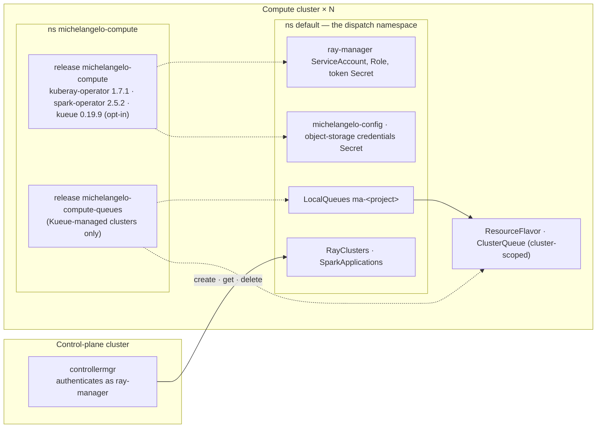

# RFC-20260805: Compute Cluster Helm Charts

- **Status:** Draft
- **Author(s):** @dragod812
- **Created:** 2026-08-05
- **Revised:** 2026-10-20

---

## Summary

Two Helm charts turn a Kubernetes cluster into a Michelangelo compute target for Ray and Spark:

| Chart | Installs | Where |
|---|---|---|
| `michelangelo-compute` | The KubeRay operator, the Kubeflow Spark Operator and, optionally, Kueue; the identity the control plane authenticates as; the runtime objects that Ray and Spark pods read | Every compute cluster |
| `michelangelo-compute-queues` | The cluster's Kueue queue objects: ResourceFlavor, ClusterQueue, LocalQueues | Kueue-managed clusters, after the first chart |

The charts are the install path for compute clusters, in the sandbox and in production, released at the platform's coordinated version ([RFC-20260616](../20260616-release-process/20260616-release-process.md)). [RFC-20260427](../20260427-michelangelo-helmchart/20260427-michelangelo-helmchart.md) gave the control plane its chart; this RFC gives compute clusters theirs.

## Problem statement

Preparing a compute cluster today means assembling five pieces by hand (as of `main`):

| Piece | Today | Problem |
|---|---|---|
| KubeRay operator | `sandbox.py` runs `helm install kuberay-operator --version 1.7.1`; the KubeRay migration guide shows the command unpinned. | The version lives in Python, and the docs already disagree with it. There is no unit to upgrade or roll back. |
| Spark Operator | The sandbox installs it unpinned, and only on the control-plane cluster. | The version floats. Dedicated compute clusters cannot run Spark. |
| Control-plane identity | `rbac-ray.yaml` is applied raw: a cluster-wide grant on `ray.io` only. The guide mints a non-expiring token Secret; the sandbox mints a 10-year token. | No Spark grant and no Kueue read access, so the Kueue backend's LocalQueue check is denied ([RFC-20260731](../20260731-kueue-integration/20260731-kueue-integration.md), P5). The grant spans every namespace although the control plane uses one. There are two token procedures. |
| Kueue and queue objects | The guide runs `helm install kueue --version 0.15.0`, then `kubectl apply`; `ma sandbox demo kueue` installs the same version. Both keep upstream defaults. | The guide's queue covers only CPU and memory, so a Ray job that sets a disk size (ephemeral storage) is never admitted. 0.19's defaults, which RFC-20260731 needs, also put Kueue's fail-closed webhook in front of every Pod create outside `kube-system` and Kueue's namespace. |
| Runtime objects | The sandbox and the guide create a `michelangelo-config` ConfigMap (storage credentials inside) and an `aws-credentials` Secret on compute clusters. | See below. |

The runtime objects fail in three ways:

- Log persistence is on by default. The collector sidecar on every Ray pod then reads the Secret named by controllermgr's `logPersistence.credentialsSecret`, through a non-optional reference. Neither the sandbox nor the guide creates that Secret on a dedicated compute cluster, so every Ray pod there fails with `CreateContainerConfigError`.
- Storage credentials sit in a ConfigMap.
- `REGISTRY_ENDPOINT` names a control-plane Service that does not resolve from another cluster.

Nothing ties these pieces together, so every adopter re-derives the sequence, and the guide has already drifted from the sandbox.

## Goals

1. One `helm upgrade --install` prepares a cluster to run Ray and Spark workloads dispatched by the control plane; a second one makes it Kueue-managed.
2. The sandbox provisions every cluster that runs Ray or Spark workloads through these charts, leaving no raw compute-side manifests or unpinned operator installs in `sandbox.py`.
3. Values that would break the control-plane contract fail at render time.
4. The charts are versioned, published and tested like the platform's other charts, including install, upgrade and uninstall.

## Non-goals

- **Registration.** Creating the `Cluster` CR and its CA and token Secrets on the control plane, and setting `scheduler_type`, stays in the registration guide. Bounded-lifetime tokens would need the control plane to refresh credentials; [enhancements#20](https://github.com/michelangelo-ai/enhancements/pull/20) does not change this credential.
- **Workload identity for object storage** (IRSA, GKE Workload Identity). The collector reads static keys from a Secret; changing that is a control-plane change.
- **Multi-flavor queues, cohorts, per-project quota and preemption.** Clusters that need them author queue objects directly. RFC-20260731 placement ranks multi-flavor and cohort queues by queue depth.
- **The NVIDIA GPU stack** (drivers, device plugin, MIG), serving workloads and control-plane components.
- **Queue semantics,** which belong to RFC-20260731.

## Design



### Components and pins

| Subchart | Pin | Why this version | Toggle (default) |
|---|---|---|---|
| `kuberay-operator` | 1.7.1 | It is what the sandbox runs today (michelangelo#2200), and it matches the History Server collector (v1.7) that controllermgr injects. Kueue's RayCluster integration needs ≥ 1.1.0. | `kuberay-operator.enabled` (`true`) |
| `spark-operator` (Kubeflow) | 2.5.2 | The latest release when this RFC was written. The floor is 2.4.0, which added the `spec.suspend` that Kueue requires. | `spark-operator.enabled` (`true`) |
| `kueue` | 0.19.9 | The 0.19 line supports Kubernetes ≥ 1.29 and carries the Spark fixes RFC-20260731 depends on. 0.20 officially supports only Kubernetes ≥ 1.34 and stops serving `v1beta1`, so the pin moves to it, raising the chart's `kubeVersion`, when 0.19 stops receiving patches. | `kueue.enabled` (`false`) |

Pins are exact and `Chart.lock` is committed. The published chart bundles its pinned subcharts, so installs need no upstream chart repository. Images still come from upstream registries, and air-gapped installs override each subchart's image repository. The chart declares `kubeVersion: ">=1.29.0-0"`, Kueue 0.19's floor, even with Kueue off, so that turning Kueue on stays a values change rather than a cluster upgrade; none of the subcharts declares one.

**One release of each chart per cluster,** named after the chart, in namespace `michelangelo-compute`:

- One release, because the charts render cluster-scoped objects and fixed names (KubeRay's `fullnameOverride`, the identity), so a second release would collide.
- A dedicated namespace, because none of the subcharts can be installed into a namespace of its own, so the release namespace holds all three operators and naming it after one of them would mislead.

### `michelangelo-compute` values

```yaml
rayManager:                          # the identity the control plane authenticates as
  create: true
  name: ray-manager                  # names the identity objects (Control-plane identity)
  tokenSecret: true                  # renders ray-manager-token (type kubernetes.io/service-account-token)
  grants:
    spark: false                     # true from the release that ships federated Spark dispatch
    kueueRead: true

runtime:                             # read by every pod the control plane creates here (ns default)
  config: {}                         # → ConfigMap michelangelo-config, rendered verbatim; MA_FILE_SYSTEM,
                                     #   AWS_ENDPOINT_URL and REGISTRY_ENDPOINT required, the Secret's two keys rejected
  objectStorageCredentials:          # → Secret with keys AWS_ACCESS_KEY_ID and AWS_SECRET_ACCESS_KEY
    name: ""                         # required: controllermgr's logPersistence.credentialsSecret
    create: false                    # true: render it from the keys below (sandbox, dev); false: managed elsewhere
    accessKeyId: ""
    secretAccessKey: ""

kuberay-operator: {enabled: true}
spark-operator:
  enabled: true
  spark:
    jobNamespaces: [default]
    serviceAccount: {name: spark-operator-spark}
  webhook:
    replicas: 2
    podDisruptionBudget: {enable: true, minAvailable: 1}

kueue:
  enabled: false                     # opt in per cluster, together with scheduler_type on its Cluster CR
  controllerManager:
    replicas: 2
    podDisruptionBudget: {enabled: true, minAvailable: 1}
    featureGates: []                 # SparkApplicationIntegration: on by default from the release
                                     #   that ships federated Spark dispatch
  managerConfig:
    controllerManagerConfigYaml: |   # upstream's default Configuration, plus these deltas:
      managedJobsNamespaceSelector:
        matchLabels: {kubernetes.io/metadata.name: default}
      integrations:
        frameworks: ["ray.io/raycluster"]   # + "sparkoperator.k8s.io/sparkapplication" with the gate
      waitForPodsReady:
        timeout: 1h
        recoveryTimeout: 0s
        requeuingStrategy: {backoffLimitCount: 2}
      resources: {excludeResourcePrefixes: ["ephemeral-storage"]}
```

The dispatch namespace is fixed at `default`, because the control plane creates every RayCluster there (`RayLocalNamespace`, a constant), and RFC-20260731 Phase 3 does the same for SparkApplications. Making it configurable later is an additive change.

**Enforced invariants.** Rendering fails if any of these is violated, as `helm/michelangelo-llm-gateway` does for its own invariants.

| Invariant | Why it is enforced rather than defaulted |
|---|---|
| `spark-operator.spark.serviceAccount.name` is `spark-operator-spark` | The control plane sets this driver ServiceAccount on every SparkApplication. Upstream derives the name from the release name, so an umbrella release silently changes it. |
| `spark-operator.spark.jobNamespaces` contains `default` | The operator ignores SparkApplications in unlisted namespaces, and it renders the driver ServiceAccount and Role only for listed ones (`[""]`, "all namespaces", renders none). |
| `runtime.config` sets the three settings and neither credential key | Each setting names something reachable from *this* cluster, so no default can be right. The two keys belong in the Secret. |
| `objectStorageCredentials.name` is set, and the keys are set exactly when `create` is true | The name must match the control plane's. Keys enter Helm values (and the release Secret) only when the chart is asked to create the Secret. |
| With `kueue.enabled`, the Configuration keeps the four deltas, and the Spark framework is listed only together with its gate | The deltas are what make Kueue safe to install here and consistent with RFC-20260731. Kueue refuses to start with the Spark framework listed but its gate off. |

### Kueue configuration

The deltas keep Kueue's webhooks out of every create path the contract does not need, and align Kueue's timers with the control plane's:

- **Frameworks: only `ray.io/raycluster`**, plus the Spark framework once the gate is on. Kueue gates only the kinds the control plane labels.
  - Disabling `pod`, `deployment` and `statefulset` switches their webhooks from `Fail` to `Ignore`, taking Kueue out of every other Pod create.
  - `batch/job` and `ray.io/rayjob` stay off. The control plane creates no Jobs on compute clusters and never labels RayJobs.
- **`managedJobsNamespaceSelector`: only `default`.** The chart derives every job webhook's namespace selector from this field. Those webhooks are `Fail` whether or not their integration is enabled; Kueue answers for disabled integrations with a no-op. Scoping confines Kueue's availability dependency to the dispatch namespace.
- **`waitForPodsReady`: a 1 h timeout, no recovery eviction, at most two requeues.** Kueue 0.19 always runs it: by default, after 30 minutes without ready pods it evicts the workload and requeues it, endlessly.
  - RFC-20260731 Phase 0 bounds provisioning itself (default 30 minutes, cumulative across evictions). Kueue's timeout is therefore only a backstop. It must exceed the longest provisioning budget in use; one hour is twice the default.
  - `backoffLimitCount: 2` ends the cycle for consumers that have no provisioning budget. After a third failed start Kueue deactivates the workload, which then stays suspended until RFC-20260731's admission bound deletes it. Two requeues absorb a transient cause, such as a slow image pull or a replaced node.
  - `recoveryTimeout: 0s` stops Kueue from evicting a running cluster that has lost a pod. KubeRay replaces the pod, whereas an eviction would delete the head and kill the job.
- **`resources.excludeResourcePrefixes: ["ephemeral-storage"]`.** Kueue blocks any workload that requests a resource its ClusterQueue does not cover. Ray pods request ephemeral storage whenever a task sets a disk size, and node-local disk is not something the platform rations by quota. Every other undeclared resource still blocks, so a GPU job is never admitted to a queue without GPU quota.
- **Two replicas with a PDB, for Kueue and for the Spark Operator's webhook.** Every replica serves webhooks. With one replica, a restart or node drain blocks the creation of RayClusters, SparkApplications or Spark pods in `default`. The operators' controllers stay single-replica, because a controller restart delays reconciliation but does not block creation. RFC-20260731 Phase 0f retries the transient create errors that remain.
- **`kueue.enabled` defaults to `false`.** Kueue is opt-in per cluster in the merged backend, and installing it on a cluster that will not be marked adds a fail-closed webhook and buys nothing. `manageJobsWithoutQueueName` keeps upstream's `false`, so a cluster with Kueue installed but not yet marked admits everything immediately.

The subchart replaces its Configuration wholesale, so the chart carries Kueue's full default with these deltas. CI fails if anything outside the deltas differs from the pinned subchart's default, which catches upstream changes at every Kueue bump. With `kueue.enabled=false`, an existing Kueue can be used if it serves `v1beta2` (≥ 0.15) and carries the same deltas.

### Queue objects: `michelangelo-compute-queues`

```yaml
clusterQueueName: cluster-queue
flavorName: default-flavor
quota: {}                            # required, e.g. {cpu: 64, memory: 256Gi, nvidia.com/gpu: 8}
localQueues: []                      # full names, e.g. [ma-california-housing]
priorityClasses: []                  # optional WorkloadPriorityClasses, e.g. [{name: low, value: 100}]
```

This renders:

```yaml
apiVersion: kueue.x-k8s.io/v1beta2
kind: ResourceFlavor
metadata: {name: default-flavor}               # empty spec: no node labels or taints
---
apiVersion: kueue.x-k8s.io/v1beta2
kind: ClusterQueue
metadata: {name: cluster-queue}
spec:
  namespaceSelector:
    matchLabels: {kubernetes.io/metadata.name: default}
  queueingStrategy: BestEffortFIFO
  resourceGroups:
  - coveredResources: [cpu, memory, nvidia.com/gpu]   # the quota keys
    flavors:
    - name: default-flavor
      resources:
      - {name: cpu, nominalQuota: 64}
      - {name: memory, nominalQuota: 256Gi}
      - {name: nvidia.com/gpu, nominalQuota: 8}
---
apiVersion: kueue.x-k8s.io/v1beta2
kind: LocalQueue
metadata: {name: ma-california-housing, namespace: default}
spec: {clusterQueue: cluster-queue}
```

Why each choice:

- **`BestEffortFIFO`** (Kueue's default). A large workload at the head of the queue does not block smaller ones that fit.
- **`namespaceSelector` matches only `default`.** Only LocalQueues in the dispatch namespace draw on Michelangelo's quota; a LocalQueue pointed at it from elsewhere stays inactive.
- **One flavor; no cohort, borrowing or preemption.** This matches what RFC-20260731 can score, and preemption would evict running clusters.
- **`quota` is required.** Quota is capacity, and no default is universally right: too low wastes the cluster, too high defeats Kueue. The schema requires scalar values, so the nested map that an unescaped `--set quota.nvidia.com/gpu=8` builds fails rendering instead of silently dropping the GPU quota.
- **Each LocalQueue name is managed by `localQueues` or by hand, never both.** Helm overwrites hand edits to the objects it renders, and deletes them when they leave `localQueues`.
- **No priority classes by default.** Whether the control plane stamps them is open in RFC-20260731, and the default set ships with that decision. A stamped class that does not exist keeps the workload from being created.

**Why a second chart rather than a toggle in the first.** Helm builds a release's whole manifest against the cluster's API before creating anything. Kueue ships its CRDs as templates, so queue objects cannot be in the release that installs those CRDs; a single chart would need two runs with different values on first install. A separate release also matches ownership and cadence: capacity owners and project onboarding change queues often, while operators change rarely. And GitOps tools can sequence two releases (Flux with `dependsOn`; Argo CD with sync waves on the two Applications of an app-of-apps).

### Control-plane identity

| Object | API group | Resources | Verbs | Why |
|---|---|---|---|---|
| Role `ray-manager` in `default` | `ray.io` | `rayclusters`, `rayjobs` | create, get, list, watch, update, patch, delete | Today's grant, narrowed to the namespace the control plane uses |
| Same Role | `sparkoperator.k8s.io` | `sparkapplications` | Same as `ray.io` | Federated Spark dispatch (`grants.spark`) |
| Same Role | `kueue.x-k8s.io` | `localqueues` | get, list, watch | The enqueue-time LocalQueue check, and RFC-20260731 Phase 2's watches (`grants.kueueRead`) |
| ClusterRole `ray-manager-clusterqueues` | `kueue.x-k8s.io` | `clusterqueues` | get, list, watch | Phase 2's watches. ClusterQueues are cluster-scoped (`grants.kueueRead`) |

A binding of the same name grants each to the ServiceAccount `ray-manager` in `default`. The cluster-scoped names differ from today's ClusterRole and binding, so both sets coexist while a cluster migrates.

Why these grants:

- **A Role, not today's ClusterRole.** Every call the control plane makes to a compute cluster targets `default`, and its health probe (`/healthz`) needs no grant. Per-project namespaces would replicate the Role.
- **The `ray-manager` name predates Spark** and is kept because registration references it.

**What a leaked token can do.** Its holder can create RayClusters (and, with `grants.spark`, SparkApplications) in `default`. That means running arbitrary images there, under any ServiceAccount in that namespace, mounting any Secret in it, the object-storage credentials included. It reaches nothing outside `default` except read access to ClusterQueues. `default` on a compute cluster should therefore hold only Michelangelo workloads and their runtime objects.

**Token lifecycle.** `tokenSecret` renders `ray-manager-token`, which registration reads, replacing both of today's token procedures. The token does not expire. To rotate it, delete the Secret and re-run `helm upgrade`: the chart recreates it with a new token, and the old one stops validating at once. The control plane picks up the re-registered token without a restart, and retries creates rejected in between (RFC-20260731 0e, 0f), so a rotation completed within ten minutes fails no job. Anything that deletes the ServiceAccount (uninstall, `rayManager.create=false`) likewise invalidates the registered token.

### Runtime contract

Every pod the control plane creates on a compute cluster reads two objects in `default`:

- **`michelangelo-config`,** rendered verbatim from `runtime.config`: the storage root, the object-storage endpoint and the model-registry endpoint, each reachable from this cluster, plus any other settings. It rejects only the two credential keys, because the chart cannot tell other secrets from settings; the tracking credentials the operator guides add still pass, and can move to the Secret.
- **The object-storage credentials Secret** (`AWS_ACCESS_KEY_ID`, `AWS_SECRET_ACCESS_KEY`), named by controllermgr's `logPersistence.credentialsSecret`. One identity serves the collector sidecar and the task containers, so it needs access to both the log bucket and the storage root.
  - controllermgr, which already names this Secret for the collector, attaches it whole to the Ray head and worker containers and the Spark driver and executor, whatever authored the job and whether or not log persistence is on. It is an optional `envFrom` source ahead of the ConfigMap: *optional*, so clusters without the Secret keep working; *ahead*, so a ConfigMap that still carries credentials keeps precedence and hand-built clusters see no change. This control-plane change ships with Phase A.
  - The sandbox's model-sync DaemonSet, which also reads these keys from the ConfigMap, reads the Secret the same way.
  - `create: false`, the production default, expects the Secret from the operator's secret management before the first job and keeps keys out of Helm values; `create: true` is for the sandbox and development. A rendered Secret carries `helm.sh/resource-policy: keep`, so neither uninstalling nor switching to `create: false` deletes credentials that running pods read.
  - Where the control plane runs on the same cluster and already provides this Secret in `default` (the sandbox, or `helm/michelangelo` installed in `default`), `create` stays `false`, because two releases cannot own one object.

`helm test michelangelo-compute` checks the contract from `default`: the Secret exists, and both endpoints are reachable. One coupling remains: controllermgr has a single `logPersistence.storageEndpoint`, which every compute cluster must reach.

### Install, upgrade, uninstall

**Install.**

```sh
helm upgrade --install michelangelo-compute oci://ghcr.io/michelangelo-ai/michelangelo/charts/michelangelo-compute \
  --version "$VERSION" -n michelangelo-compute --create-namespace -f cluster.yaml --wait
# Kueue-managed clusters (cluster.yaml sets kueue.enabled: true), once the first command has returned:
helm upgrade --install michelangelo-compute-queues oci://ghcr.io/michelangelo-ai/michelangelo/charts/michelangelo-compute-queues \
  --version "$VERSION" -n michelangelo-compute -f queues.yaml --wait
```

`--wait` returns once Kueue's CRDs are Established and its Deployment is Ready. With Kueue's internal certificate management (the default), Ready implies that its webhook certificates are in place, so the second release's objects pass validation; with cert-manager (`enableCertManager`), the CA bundle arrives asynchronously, and the second command may need a retry. Both commands are idempotent, and onboarding a project means appending to `localQueues` and re-running the second.

**Upgrade.**

- **Kueue** ships its CRDs as templates, so `helm upgrade` and `helm rollback` reconcile them.
- **KubeRay and the Spark Operator** ship their CRDs in `crds/`, which Helm creates at first install, if absent, and never upgrades or rolls back. Wherever those CRDs may be older than the chart's (a first install over an existing operator, or a release that bumps either pin), they are applied first; otherwise the new operator runs on the old schema, and the API server silently drops every field it lacks:
  - Helm CLI: `helm show crds <chart> --version "$VERSION" | kubectl apply --server-side --force-conflicts -f -`, minus the CRDs of an operator kept standalone (`helm show crds` prints every subchart's). Server-side, because five of these CRDs exceed client-side apply's 256 KiB annotation limit; `--force-conflicts`, because Helm or a GitOps tool created them.
  - Flux: `install.crds` and `upgrade.crds` set to `CreateReplace`. Argo CD applies `crds/` on every sync and needs `ServerSideApply=true` for them.
  - One procedure covers both operators. Spark's opt-in pre-upgrade hook (`hook.upgradeCrd`) has no KubeRay counterpart, and adds a Job, an image and CRD write access to every install and upgrade. A CRD-only release would expose the CRDs to `helm rollback` and `helm uninstall`, which can drop fields or delete every object: the risk `crds/` exists to avoid.
  - `helm rollback` leaves these CRDs at the newer schema, so pin bumps are reviewed for CRD backward compatibility.
- **Running workloads.** An upgrade restarts the operators' controllers, which resume reconciling existing RayClusters and SparkApplications. It must not restart their pods; the upgrade e2e asserts this with a live RayCluster.
- **Order.** Phase A upgrades the control plane first: the chart's ConfigMap carries no credentials, so task pods must already read the Secret, and the new control plane changes nothing on hand-built clusters (Runtime contract). After Phase A, compute clusters upgrade first: chart changes that a control-plane release relies on (grants, Kueue configuration) ship in the same platform release and are additive, so a compute cluster may run one release ahead of its control plane, never behind.

**Uninstall** is destructive for Kueue and runs in this order:

1. Unmark the cluster (`scheduler_type` back to default), so no new workloads are labeled.
2. Wait until `kubectl get workloads -n default` returns nothing.
3. Uninstall `michelangelo-compute-queues`. The ClusterQueue and ResourceFlavor carry Kueue's in-use finalizer, which Kueue releases only once no workload holds quota, as step 2 ensures.
4. Uninstall `michelangelo-compute`, or set `kueue.enabled=false`. Either one deletes Kueue's CRDs. Done before step 3, it would strand the queue objects behind finalizers that no controller clears.

KubeRay's and Spark's CRDs survive, along with their objects, because Helm never deletes `crds/`; so does a chart-created credentials Secret. Uninstalling also deletes `ray-manager`, so deregister the cluster first. The order is not enforced: the Kueue chart offers no way to keep its CRDs, and a `lookup`-based guard would break offline rendering (`helm template`, GitOps).

### Migrating existing clusters

Helm installs over an existing object only if it carries the release's ownership metadata (the `meta.helm.sh/release-name` and `meta.helm.sh/release-namespace` annotations and the `app.kubernetes.io/managed-by: Helm` label) or, from Helm 3.17, with `--take-ownership`; otherwise the install aborts. Adding that metadata is how an object is *adopted* below.

**Operator releases.** Taking over objects that another release owns would leave two releases claiming them, and uninstalling either would delete them. A standalone install therefore moves in one of two ways, per component:

- **Replace.** Uninstall the standalone KubeRay or Spark release, then install the chart, applying its CRDs first (Upgrade), because Helm skips `crds/` that already exist. The CRDs, which Helm never deletes, keep existing RayClusters and SparkApplications alive, and the new operator resumes reconciling them. A standalone Kueue is different: uninstalling it deletes its CRDs with every Workload and queue, so drain it and delete its queue objects first, as in steps 1–3 above; the queues chart recreates them.
- **Keep.** Set `<subchart>.enabled=false` and keep the standalone release. The charts still provide the identity, the runtime objects and the queue objects, but that component's pin and enforced configuration no longer apply.

**Hand-built objects,** from the registration guide or an older sandbox, are handled at the first install, which Phase A's control plane must precede (Order):

| Object | At the first install |
|---|---|
| ServiceAccount `ray-manager`, Secret `ray-manager-token` | Adopted. Recreating either invalidates the registered token. |
| Role and RoleBinding `ray-manager`, ClusterRole and ClusterRoleBinding `ray-manager-clusterqueues` (Kueue read grants built by hand, RFC-20260731 0d) | Adopted. The chart's rules replace theirs. |
| ClusterRole `ray-manager`, ClusterRoleBinding `ray-manager-binding` | Deleted after the install, so dispatch never loses permission. Deleting them is what narrows `ray-manager`. |
| ConfigMap `michelangelo-config` | Deleted just before the install, once its other keys are in `runtime.config`. Adopting it would keep the credential keys, because Helm leaves keys it never rendered. Pods that start in between wait until the chart recreates it. |
| Secret `aws-credentials` | Left alone: the chart does not render it, and nothing Michelangelo runs on a compute cluster reads it. |
| Queue objects | With a kept Kueue, adopted, or kept by hand and left out of `localQueues`. Replacing Kueue deletes them first (Replace). |

### Sandbox integration

`sandbox.py` installs `michelangelo-compute` on every cluster that runs Ray or Spark workloads: the control-plane cluster in both modes, since Spark runs there until federated Spark dispatch ships, and each `--create-compute-cluster` cluster. The inference demo's remote clusters run neither and keep their own objects. The chart replaces the imperative KubeRay and Spark installs, `rbac-ray.yaml`, and the hand-built ConfigMap and Secret. Specifically:

- `--exclude ray` and `--exclude spark` map to `kuberay-operator.enabled=false` and `spark-operator.enabled=false`.
- Runtime values point at the control plane's MinIO and apiserver, over the shared Docker network from compute clusters.
- On the control-plane cluster, the chart references the sandbox's existing credentials Secret (`create: false`). Compute clusters get the Secret from the chart.
- A reused sandbox cluster is migrated as described in Migrating existing clusters.
- `ma sandbox demo kueue` sets `kueue.enabled=true`, installs the queues chart with the demo quota (8 CPU, 16Gi), and marks the `Cluster` CR.

### Release and CI

- **Release.** The charts live at `helm/michelangelo-compute` and `helm/michelangelo-compute-queues`. Each chart's `version` and `appVersion` equal the platform version (RFC-20260616), and the release workflow publishes both to `oci://ghcr.io/michelangelo-ai/michelangelo/charts` beside `michelangelo` and `michelangelo-llm-gateway`.
- **Monitoring.** The subcharts' monitor toggles (Kueue `enablePrometheus`, KubeRay `metrics.serviceMonitor.enabled`, Spark `prometheus.podMonitor.create`) are surfaced, off by default like the other charts'.
- **Render checks** run on every chart change: `helm dependency build`, `helm lint`, and template assertions. The assertions cover:
  - the default profile;
  - Kueue enabled;
  - queues with two LocalQueues;
  - each invariant failing as specified;
  - the Configuration diff against upstream's default.

  Both charts join the Helm versions that `compat-matrix.yml` tests (3.13 to 3.15, so 3.13 is the minimum) and the values API-surface check, which flags removed or renamed keys.
- **End to end.** The existing sandbox e2e provisions through the chart, so its Ray and Spark jobs run on chart-installed operators. A new k3d job, running `helm test` after each install and upgrade:
  - installs both charts with Kueue and admits one labeled RayCluster;
  - migrates a hand-built cluster with a standalone KubeRay (Replace), running a Ray job before and after;
  - upgrades from the previous released chart (for the first release, a build pinning older KubeRay and Spark Operator versions), CRD step included, with a RayCluster running throughout;
  - uninstalls in the documented order.

## APIs and CRDs

There are no new CRDs, protos or service APIs. The public surface is both charts' values and enforced invariants, the rendered objects above, the OCI chart references, and the upgrade order.

## Alternatives considered

**A. Keep the imperative installs (status quo).**
- *Rejected:* no versioned unit, an unpinned Spark Operator, and docs that mirror a Python sequence by hand, which have already drifted.

**B. Upstream charts as independent releases, plus a small chart for identity, runtime and queues.**
- Each operator would keep its own release and cadence, but the composition contracts (the pins, Kueue's Configuration deltas, the Spark ServiceAccount name, the job namespaces) would move into per-adopter values files that nothing validates, and their drift is what this RFC removes.
- *Rejected,* but the option survives: every subchart can be disabled and run standalone (Migrating existing clusters).

**C. Fold the compute objects into `helm/michelangelo`.**
- *Rejected:* the two charts target different clusters, with different cardinality (one versus N) and different lifecycles. When one cluster plays both roles, both charts are installed on it.

**D. Queue objects in the operators' release, through a second run with different values or through a post-install hook.**
- *Rejected:* one release cannot hold both (Why a second chart), a second run with different values cannot be expressed in GitOps, and hooks cannot own long-lived objects, which they recreate or orphan on every upgrade.

**E. Ray first, Spark later.**
- *Rejected:* the identity, the Spark ServiceAccount and namespace contracts, and the runtime objects are cheapest to fix while the chart is new, and a Ray-only cluster cannot run half of Michelangelo's batch workloads.

## Open questions

None in this RFC. Control-plane-created LocalQueues and the priority-class set are open in RFC-20260731.

## Rollout strategy

| Phase | Ships | Compatibility |
|---|---|---|
| A | `michelangelo-compute` with KubeRay, the Spark Operator, the identity and the runtime contract (with the task-credentials change), plus the invariants, `helm test`, CI and OCI publishing. The sandbox switches to it. | The control plane upgrades first. The Spark Operator becomes pinned and lands on dedicated compute clusters, idle until federated Spark dispatch. A migrated cluster's `ray-manager` narrows to `default` once today's ClusterRole is deleted; the control plane uses nothing outside it. |
| B | The Kueue subchart (opt-in) and `michelangelo-compute-queues`. `ma sandbox demo kueue` switches to them. | Inert until a cluster is marked. Marking clusters outside a sandbox waits for RFC-20260731 Phase 0. |

Rollback is a `helm rollback` of the affected release, and Kueue's removal follows the uninstall order above. Phase A's control plane rolls back only while no compute cluster runs the chart, because older task pods read credentials only from the ConfigMap.

## References

- [RFC-20260427](../20260427-michelangelo-helmchart/20260427-michelangelo-helmchart.md), the control-plane chart; [RFC-20260616](../20260616-release-process/20260616-release-process.md), coordinated releases and GHCR OCI charts; [RFC-20260731](../20260731-kueue-integration/20260731-kueue-integration.md), the queueing and placement semantics these charts install for.
- [michelangelo#1985](https://github.com/michelangelo-ai/michelangelo/pull/1985), the Kueue backend. Guides: `docs/operator-guides/jobs/kueue-scheduler-backend.md` and `docs/operator-guides/setup/register-a-compute-cluster-to-michelangelo-control-plane.md`.
- `helm/michelangelo-llm-gateway`, the precedent for wrapper invariants, OCI dependencies and chart publishing.
- Upstream charts:
  - [kuberay-operator](https://github.com/ray-project/kuberay-helm)
  - [Kubeflow spark-operator](https://github.com/kubeflow/spark-operator/tree/master/charts/spark-operator-chart)
  - Kueue (`oci://registry.k8s.io/kueue/charts/kueue`): [installation](https://kueue.sigs.k8s.io/docs/installation/), [waitForPodsReady](https://kueue.sigs.k8s.io/docs/tasks/manage/setup_wait_for_pods_ready/), [SparkApplication integration](https://kueue.sigs.k8s.io/docs/tasks/run/kubeflow/sparkapplications/)
- Helm: [custom resource definitions best practices](https://helm.sh/docs/chart_best_practices/custom_resource_definitions/).
