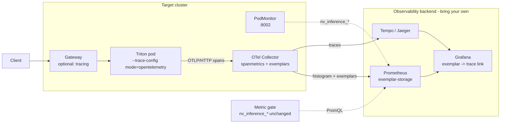

# RFC-20261115-triton-prometheus-exemplars: Prometheus exemplars for Triton inference observability

- **Status:** Draft
- **Author(s):** @sallycr
- **Created:** 2026-11-15

---

## Problem statement

Operators of Michelangelo inference servers can see that p99 latency for a model went up, but cannot jump from
that latency spike to the slow request that caused it. Prometheus exemplars (a trace ID attached to a histogram
sample) provide that link, and nothing in the serving path can produce them today:

- Triton (default image built from `tritonserver:25.01-py3`) serves `nv_inference_*` on `:8002` as plain text.
  No Triton release through 26.10 emits exemplars or OpenMetrics: Triton serializes with prometheus-cpp's text
  serializer, and prometheus-cpp has no exemplar support (upstream issue open).
- Envoy and the Istio gateway in the serving path do not export exemplars either.
- Nothing scrapes Triton by default. The chart's only `ServiceMonitor` covers controllermgr, and the sandbox
  Prometheus has one scrape job (controllermgr) and no exemplar storage.
- Triton settings (drain, probes, metric gate) are not reachable from Helm: the chart ConfigMap replaces the
  whole controllermgr config and renders only `triton.defaultImage`.

## Motivation

Latency regressions on a model are diagnosed today by correlating dashboards with logs by timestamp. Exemplars
shorten that to one click, and the same trace data gives a per-request breakdown (queue vs compute) that no
metric offers. Doing this as an opt-in, vendor-neutral feature (OpenTelemetry, Prometheus, Grafana) also fixes
the prerequisite gap that Triton is not scraped at all, which also affects the existing metric gate regardless
of exemplars (the gate's own empty-result behavior is tracked separately, see Related issues).

## Goals

- Provide an opt-in path from a Triton latency histogram point in Grafana to the trace of a sampled request.
- Keep the default install and `ma sandbox create` unchanged: with the feature off, the Triton pod template is
  byte-identical to today's, so upgrading restarts no pods.
- Make Triton metrics scrapeable from the chart with a `PodMonitor`, independent of tracing.
- Expose every new setting through Helm, with misconfiguration failing at `helm template` or controller
  startup rather than silently.
- Keep the metric gate and alerts on the full-population `nv_inference_*` metrics.

## Non-goals

- Patching Triton or prometheus-cpp to emit exemplars natively.
- Exemplars on gateway/Envoy metrics (Envoy does not export them), or a Michelangelo-owned proxy sidecar.
- Replacing `nv_inference_*` as the source for SLOs, alerts or the metric gate.
- Shipping or operating Tempo/Jaeger or Prometheus in the production chart (bring your own).
- Fixing the metric gate's empty-result behavior or the Envoy alert wiring (tracked as separate issues, see
  Related issues).
- Backend-neutral observability config for non-Triton backends (see Open questions).

## High-level architecture

Triton cannot emit exemplars, so exemplars are derived from traces: Triton exports OpenTelemetry spans, an
OpenTelemetry Collector's span-metrics connector turns spans into a latency histogram carrying the span's
`trace_id` as an exemplar, Prometheus stores it, and Grafana links the exemplar to the trace backend.



Two series exist side by side and must not be confused:

| Series | Source | Population | Use |
|---|---|---|---|
| `nv_inference_*` | Triton `/metrics` via PodMonitor | all requests | gate, alerts, SLOs |
| span-derived latency histogram (e.g. `traces_span_metrics_duration_*`) | Collector span-metrics | traced requests only | drill-down with exemplars |

Design points verified against upstream sources (versions in the research notes):

- Triton trace flags: `--trace-config mode=opentelemetry`, `level=TIMESTAMPS` (default OFF), `rate=N`,
  `opentelemetry,url=<OTLP/HTTP>` and `opentelemetry,resource=k=v`. OTLP/HTTP only.
- A request produces three SERVER-kind spans (`InferRequest`, one named after the model, `compute`); span
  attributes in code are `triton.model_name` / `triton.model_version`. The collector must filter by span name
  and use the real attribute names.
- Triton 25.01 has a segfault under OpenTelemetry load fixed in 25.04. Enabling tracing therefore requires
  Triton >= 25.04, which is a separate base-image change from this RFC's code.
- Triton traces any request carrying a valid W3C `traceparent` regardless of the sampled flag. If sampling is
  done at the gateway, the gateway must not propagate context for unsampled requests (to be prototyped).
- The span-metrics connector is alpha (renamed `span_metrics`) with pending breaking changes behind feature
  gates; the collector version must be pinned. Exemplars require an explicit-bucket histogram and the
  Prometheus exporter with `enable_open_metrics: true`, or Prometheus's OTLP receiver.
- Prometheus exemplar storage is still behind `--enable-feature=exemplar-storage`. With the Prometheus
  Operator: `spec.enableFeatures`, `spec.exemplars.maxSize`.

## APIs and CRDs

No proto/CRD change in v1. New operator-level controller config and Helm values, all default-off.

Controller config (`go/base/config/config.go`, extending `TritonConfig`, following the `drain`/`probes` pattern):

```yaml
inferenceServer:
  triton:
    observability:
      podLabels: false          # stable labels so one PodMonitor can select Triton pods
      tracing:
        enabled: false
        endpoint: ""            # OTLP/HTTP traces URL, required when enabled
        sampleRate: 1000        # Triton rate=N: trace 1 in N requests
        level: TIMESTAMPS
        resourceAttributes: {}  # service.name defaults to the InferenceServer name
```

When `tracing.enabled`, the Triton backend adds `--trace-config` args and, if `endpoint` references `$(HOST_IP)`,
the `HOST_IP` env var. `enabled` with an empty `endpoint` is a startup error. A pinned unit test asserts the
pod template (and its spec hash) is unchanged when every field is zero.

Helm values (`helm/michelangelo/values.yaml`; the chart ConfigMap template renders the same block):

```yaml
inferenceServer:
  triton:
    observability: { podLabels: false, tracing: { enabled: false, endpoint: "", sampleRate: 1000 } }
monitoring:
  tritonPodMonitor:             # CRD-gated on monitoring.coreos.com/v1; needs podLabels
    enabled: false
    interval: 15s
  otelCollector:                # optional, CRD-gated on opentelemetry.io; off = bring your own
    enabled: false
```

Notes:

- Triton pods run in target clusters, not necessarily the control-plane cluster, and the existing Triton
  `Service` does not expose `:8002`, so a `PodMonitor` is used (not a `ServiceMonitor`). For remote target
  clusters the same manifest is documented for standalone apply.
- Toggling `podLabels` or `tracing` changes the pod template and rolls Triton pods once (drain applies).
- Sandbox: a single opt-in flag (e.g. `ma sandbox create --include-experimental tracing`) adds the collector,
  a trace backend, exemplar storage on the sandbox Prometheus and the Grafana datasource link. Default
  `ma sandbox create` is unchanged.
- Deferred: a per-InferenceServer `ObservabilitySpec` proto field (tracing override, sample rate). Not in v1.

## Alternatives considered

### Alternative A (chosen): Triton OTel traces -> Collector span-metrics -> exemplars
**Pros:** vendor-neutral; no new Michelangelo-owned data-plane component; per-request breakdown from the trace
view; downstream reusable by other backends later.
**Cons:** span-derived histogram covers only sampled requests (undercounts by about the sampling factor);
Triton tracing overhead is unmeasured; version coupling to Triton's tracing flags; collector must be reachable
from every target cluster.
**Mitigation:** gate/alerts stay on `nv_inference_*`; Triton >= 25.04 required; prototype before choosing the
default sample rate.

### Alternative B: Gateway-side tracing as the exemplar source
Enable tracing on the Istio gateway and derive exemplars from gateway spans.
**Pros:** uniform across backends; covers queueing before Triton; works with Triton images too old for OTel.
**Cons:** Envoy itself exports no exemplars, so this still needs span-metrics; couples to Istio specifics the
chart does not manage; weaker per-model attribution; gives no in-server breakdown.
**Why not chosen:** kept as an optional complement (it is also the likely place to sample), not the primary.

### Alternative C: Sidecar/proxy that records its own histogram with exemplars
A proxy in front of Triton records `ObserveWithExemplar` histograms on every request.
**Pros:** exemplars on all requests; independent of Triton version.
**Cons:** extra hop on the hot path; breaks probe and pod-proxy paths that address `:8000` directly; a new image
to build, scan and version; duplicates `nv_inference_*`.
**Why not chosen:** highest maintenance cost. Fallback if sampling bias proves unacceptable.

### Alternative D: Patch Triton / prometheus-cpp for native exemplars
**Why not chosen:** requires upstream changes with no committed timeline (prometheus-cpp exemplar issue open
since 2021); Michelangelo cannot depend on it.

### Alternative E: Latency histograms only (`histogram_latencies`), no exemplars
On 25.01 this adds only a first-response histogram for decoupled models; broader request/queue/compute
histograms were merged upstream after the 26.10 release and are not in any release yet. Useful for percentiles,
but gives no link to traces. Complementary, not a substitute.

## Open questions

- [ ] Triton OTel overhead and the right default `sampleRate` (no published numbers; needs a prototype).
- [ ] Sampling location: sample at the gateway and run Triton with `rate=0`, or sample at Triton? Triton ignores
      the incoming sampled flag (upstream issue open), so gateway sampling must withhold context for unsampled
      requests.
- [ ] Collector topology across target clusters: per-cluster, node-local (`$(HOST_IP)`), or central.
- [ ] Exemplar transport: Prometheus exporter with OpenMetrics scrape vs Prometheus OTLP receiver.
- [ ] Add stable pod labels unconditionally (one restart on upgrade) or behind `podLabels` (proposed)?
- [ ] Fix the broader Helm config gap (expose drain, probes, readinessProbe, metricGate) in a separate PR first?
- [ ] Backend-neutral `inferenceServer.observability` vs Triton-specific `triton.observability`.
- [ ] Security: unauthenticated in-cluster OTLP endpoint; ensure spans carry no request headers or payload
      data; confirm Triton's trace-settings endpoint is not reachable through the gateway.
- [ ] Minimum supported Triton version (>= 25.04 proposed) and the image bump plan; custom per-server images may
      be older.
- [ ] Prometheus image pinning in the sandbox (currently unpinned `latest`).

## Rollout strategy

| Phase | Content | Default | Sandbox impact |
|---|---|---|---|
| 0 | Triton pod labels + `tritonPodMonitor` + docs (makes `nv_inference_*` available to the gate) | off | none |
| 1 | `triton.observability.tracing` in Go config, Helm and ConfigMap; template-identity test; Triton >= 25.04 check | off | none |
| 2 | Collector reference config (+ optional chart CR); Prometheus/Grafana docs; serving dashboard with exemplar panel; sandbox opt-in flag | off | opt-in only |
| 3 | Prototype-gated tuning: overhead and sampling measurements, default sample rate, dimensions | n/a | validation evidence |
| 4 (optional) | Gateway tracing doc and sandbox opt-in | off | opt-in only |
| 5 (optional) | Per-InferenceServer override (proto) | n/a | none |

Proposed implementation PR split: (0) optional Helm exposure of existing Triton settings, (1) PodMonitor and
labels, (2) tracing args and config, (3) sandbox flag, (4) docs and dashboard. Feature flags: all behind the
`observability.*` and `monitoring.*` toggles above; upgrade with everything off produces no pod template change.
Rollback: set the toggles to false (Triton pods roll once, drained).

## Related issues

Found while preparing this RFC, deliberately out of its scope:

- michelangelo-ai/michelangelo#2435: the deployment metric gate passes silently when its query returns no data.
- michelangelo-ai/michelangelo#2436: `envoyAlerts` and `monitoring.md` target the UI-proxy Envoy, not the inference gateway.

## References

- Triton metrics and tracing docs, `trace-config` and `--metrics-config` (NVIDIA Triton Inference Server)
- prometheus-cpp exemplar support tracking issue
- OpenTelemetry Collector `spanmetricsconnector` and `prometheusexporter` docs
- Prometheus feature flags: exemplar storage; Prometheus Operator `enableFeatures`
- Grafana Prometheus datasource: `exemplarTraceIdDestinations`
- KServe OpenTelemetry tracing and `OTEL_*` env injection (closest prior art for the config surface)
- Michelangelo: `go/components/inferenceserver/backends/triton.go`, `helm/michelangelo/templates/monitoring/`
